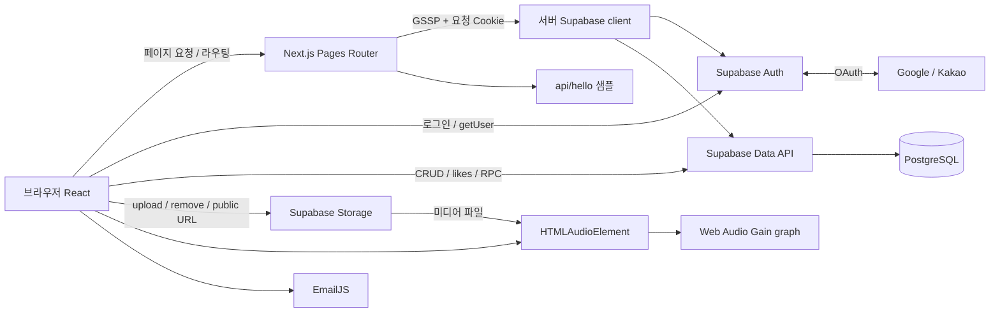
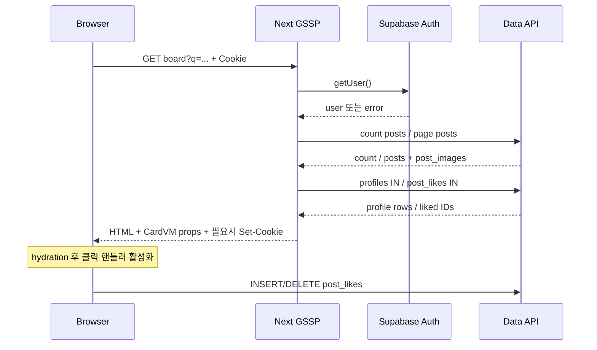
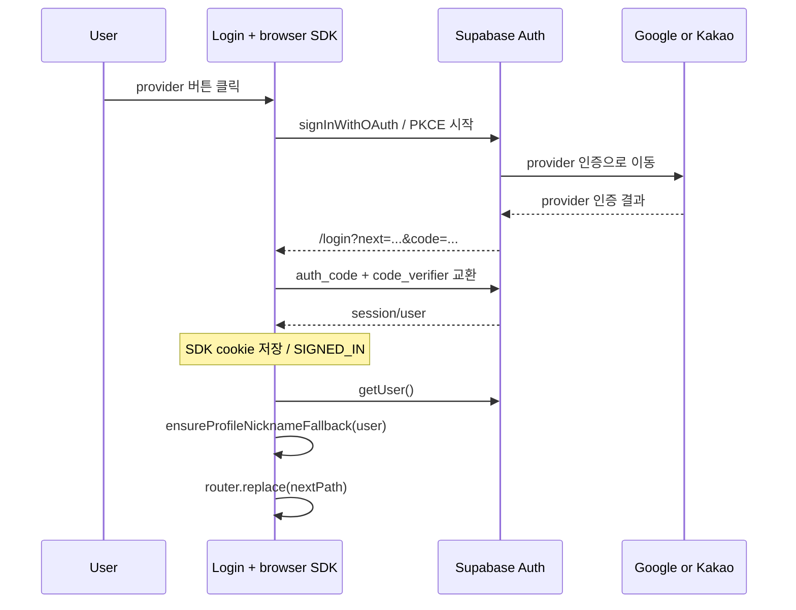
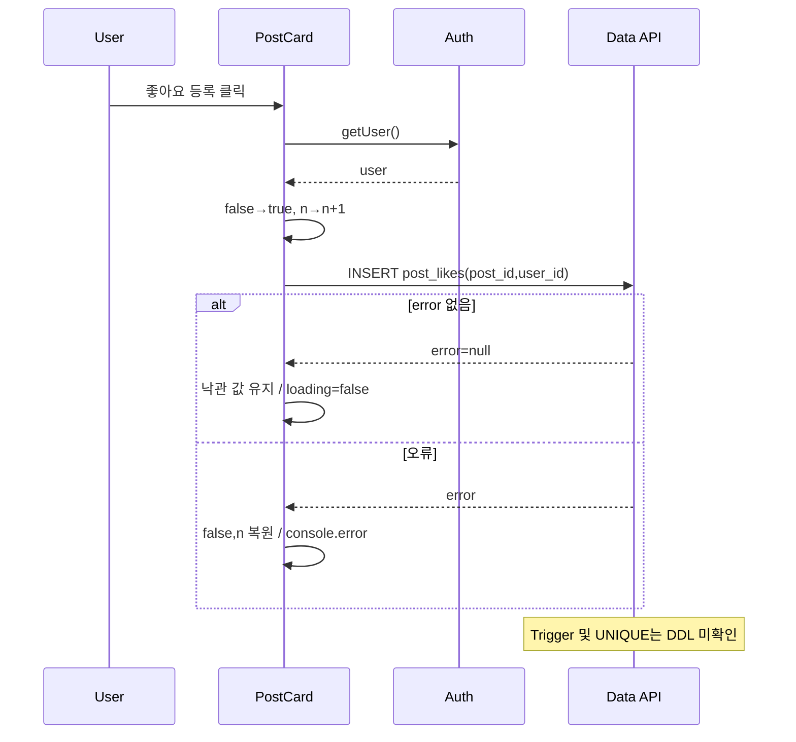
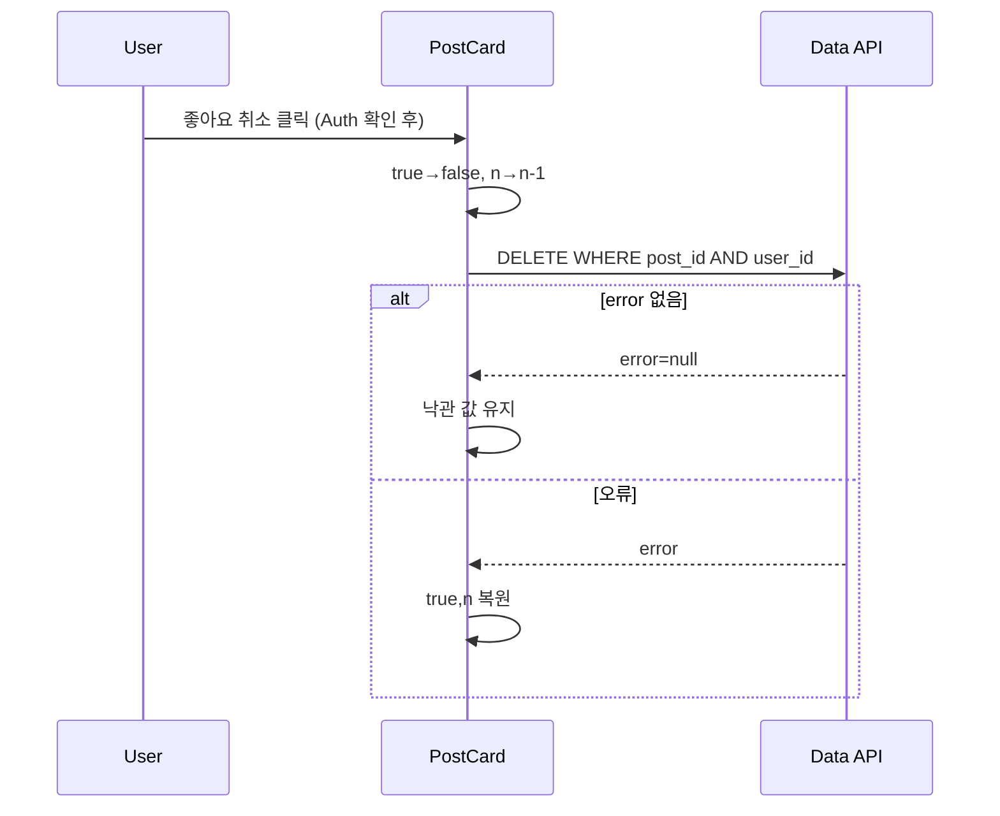
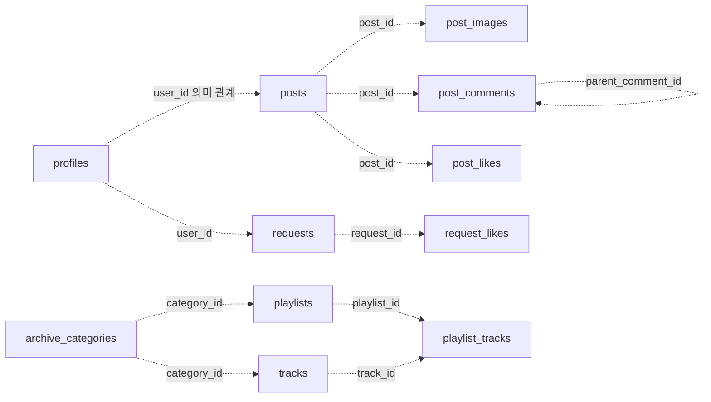
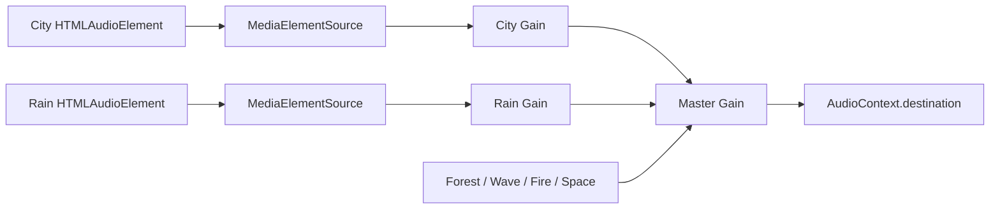

# Calmato Web 기술 심층 분석 · 면접 대비

> 분석일: 2026-10-14 · 기준 커밋: `c1005bc8f497c5f59709682743b3be141079403d` · 현재 작업 트리 정적 분석
>
> 이 문서는 소스 코드의 실행 경로를 설명한다. 운영 DB, OAuth 콘솔, Storage 정책, 실제 배포 환경과 성능은 검증하지 않았다. 애플리케이션 코드를 수정하거나 운영 데이터에 요청을 보내지 않았다.

## 0. 읽는 순서와 증거 기준

면접 직전에는 1절의 핵심 사실, 12절의 질문, 13절의 핵심 포인트를 먼저 읽는다. 구현 복습은 인증 → 게시글 → 좋아요 → Storage → ASMR 순서가 적합하다. HTML판은 같은 본문과 파일별 줄 번호가 있는 코드 근거 모음을 제공한다.

| 표시 | 의미 |
|---|---|
| [코드 확인] | 애플리케이션 또는 명시된 설치 SDK 소스에서 확인한 동작. 실행 성공을 의미하지 않음 |
| [설정 확인] | package.json, lockfile, Next.js·TypeScript 등 저장소 설정 |
| [추론] | 코드의 조건과 호출 순서에서 도출한 효과·위험. 과거 장애 이력이 아님 |
| [확인 필요] | 운영 설정, DB DDL, 정책, 측정 결과, 당시 개발 의도 등 추가 근거 필요 |
| [개선 제안] | 현재 구현과 분리한 향후 변경안 |

분석 범위는 `pages`, `components`, `hooks`, `lib`, 스타일·설정, `album.json` 및 관련 설치 SDK다. 빌드 산출물·에셋 바이너리는 애플리케이션 로직과 구분했다. SQL·마이그레이션·RLS 정책 파일은 발견되지 않았다. `README.md`는 기본 Next.js 안내이며 실제 설계·장애 기록으로 사용하지 않는다. 코드의 오래된 `src/` 주석과 달리 실제 경로는 루트 `lib/`, `components/`, `pages/`다.

## 1. 프로젝트 개요와 핵심 사실

[코드 확인] Calmato는 음악·플레이리스트·월페이퍼 아카이브, 게시판·댓글·신청곡 커뮤니티, 브라우저 ASMR Mixer, 관리자 콘텐츠 관리 화면을 결합한다. `pages/index.tsx`의 소개와 기능 경로에서 서비스 구성을 확인할 수 있다. [추론] 사용자 요구를 기능으로 재구성하면 “콘텐츠를 탐색하고, 소리를 섞어 들으며, 계정으로 참여하고, 관리자가 자료를 등록하는 것”이다. 이것을 개발 당시 확정된 요구사항 문서라고 주장하지 않는다.

| 면접에서 혼동하기 쉬운 주장 | 현재 코드에 맞는 표현 |
|---|---|
| 모든 요청이 Next.js API를 거친다 | SSR 최초 조회는 Next.js, 대부분 변경 요청은 브라우저 → Supabase 직접 호출 |
| 모든 페이지가 SSR이다 | 게시판 목록·상세, 신청곡, 플레이리스트 상세, 관리자 8개 페이지에 GSSP 존재. Archive 목록은 CSR 조회 |
| OAuth 콜백 API를 직접 만들었다 | 자체 콜백 API 없음. `/login`과 설치 SDK의 PKCE URL 처리에 의존 |
| SSR은 service role로 DB에 접속한다 | 서버·브라우저 모두 public URL과 anon key 사용. 서버에는 요청 쿠키 전달 |
| 댓글 좋아요도 영속 저장된다 | `toggleCommentLike`는 컴포넌트 State만 바꿈 |
| Trigger로 좋아요 집계가 보장된다 | 클라이언트는 likes 테이블과 집계 컬럼을 사용하지만 Trigger DDL은 없음 |
| ASMR이 끊김 없는 크로스페이드 루프다 | `audio.loop=true`, 재생·정지 시 0.7초 gain ramp. 루프 경계 중첩 재생은 없음 |
| 업로드는 트랜잭션으로 롤백한다 | DB·Storage별 요청과 best-effort 보상 삭제. 원자적 트랜잭션 아님 |
| 관리자 메뉴를 숨기면 안전하다 | GSSP role 검사도 있지만 직접 Data API 요청의 최종 방어는 DB·Storage 정책 |
| 성능 최적화 효과를 측정했다 | 캐시·일괄 조회·GPU 자원 제한은 확인. 지연시간·FPS·부하 측정은 없음 |

## 2. 전체 아키텍처와 기술 역할

### 2.1 기술 스택과 실제 연결

| 기술 | 확인된 역할과 파일 | 버전·검증 범위 |
|---|---|---|
| Next.js Pages Router | `pages/*`, `getServerSideProps`, `_app.tsx`, API sample | [설정 확인] manifest `^16.1.2`, lockfile 16.2.6 |
| React | State·Props, DOM·Audio refs, effects | [설정 확인] manifest `^19.0.0`, lockfile 19.1.0 |
| TypeScript | `BoardPostRow`, `RequestItem`, `AmbientChannelId`, union 상태 | `strict:true`, `allowJs:true`, `@/*` 루트 alias |
| Supabase SSR SDK | 브라우저 cookie storage / GSSP cookie adapter | lockfile `@supabase/ssr` 0.8.0 |
| Supabase JS | Auth, `.from()` Data API, `.storage`, `.rpc()` | lockfile 2.90.1 |
| PostgreSQL | 테이블·관계 조회 대상 | [확인 필요] 자료형·제약조건·정책·함수 본문 |
| Web Audio + HTMLAudioElement | `hooks/useAmbientMixer.ts` | MediaElementSource → 채널 Gain → master Gain |
| HTML `<audio>` | `components/SimplePlayer.tsx` | Archive 개별 트랙, audio.volume·미디어 이벤트 |
| Tiptap | `pages/community/board/write.tsx` | 제한된 StarterKit + Underline, HTML 저장 |
| Framer Motion | Navbar, About, TrackRow, Mixer UI | Audio DSP를 처리하는 라이브러리는 아님 |
| WebGL | `components/about/useWaterRipples.ts` | 셰이더 배경 굴절·포인터 파동 |
| next-themes / Tailwind / CSS Modules | `_app.tsx`, `styles/*` | ThemeProvider와 전역·모듈 스타일 |
| react-player / EmailJS | Archive 상세 YouTube / Contact 발송 | 각 브라우저 기능. Contact는 Next API 미사용 |
| Vercel | README 배포 안내 | 실제 배포 프로젝트·지역·환경변수·로그 미확인 |

버전 범위와 lockfile 해석을 구분한다. 설치 버전의 런타임 호환성을 빌드·브라우저 E2E로 보증한 문서는 아니다. `eslint-config-next`는 manifest 15.3.4이고 Next manifest major는 16이며, lint 스크립트는 `next lint`다. [확인 필요] 현재 도구 체인에서 이 조합의 실행 결과를 확인해야 한다.

### 2.2 요청 경계



[코드 확인] 앱에서 사용하는 API Route는 샘플 `pages/api/hello.ts` 하나이며 `{name: "John Doe"}`를 반환한다. 게시글 CRUD·OAuth callback·업로드의 BFF가 아니다. `.from("posts").insert(...)`는 브라우저 SDK가 Supabase에 보내는 요청이고 별도 `/api/posts` 구현은 없다. `.rpc("increment_post_view", {p_post_id})`도 Supabase RPC이며 Next API가 아니다.

[확인 필요] 위 DB 노드는 애플리케이션이 의존하는 저장 계층이다. RLS·Trigger가 배치되어 작동함을 도식이 보증하지 않는다. Storage의 `getPublicUrl()`은 URL 생성이며 파일 존재, 다운로드 가능, 정책 충족을 검사하는 조회가 아니다.

### 2.3 페이지와 컴포넌트의 소유 관계

| 진입점 | 자식·Props·State | 최초 데이터 |
|---|---|---|
| `_app.tsx` | ThemeProvider, Navbar, Iconset, AmbientMixer, Component에 pageProps | 페이지별 전략 |
| `/` | Home 이미지·문구·motion | 정적 구성 / Storage URL |
| `/about` | 3개 슬라이드, WaterSurfaceWebGL → useWaterRipples | 정적 구성·이미지·영상 |
| `/archive` | `tab`, categories, playlists → ArchiveTabs·PlaylistsView·TracksView·ThumbnailsView | effect에서 categories/playlists 병렬 조회 |
| `/archive/[slug]` | `album` → ReactPlayer·DescriptionSection·곡 목록 | GSSP 관계 조회 → mapper |
| `/community` | 커뮤니티 진입 링크 | DB 조회 없음 |
| `/community/board` | cards → PostCard, q·sort·page URL | GSSP |
| `/community/board/[id]` | post·images·initialComments·allPosts·viewer → 로컬 State | GSSP 후 클라이언트 쓰기 |
| `/community/board/write?edit=id` | WritePage 입력·파일·Tiptap → PostBackgroundPicker | effect 인증 / 수정 대상 조회 |
| `/community/request` | top/list/likedSet → 카드·행·생성/수정·상세 모달 | GSSP + refreshVisibleData |
| `/login`, `/signup`, 비밀번호 2페이지 | 폼 State → Supabase Auth | effect/submit CSR |
| `/contact` | name/email/message/loading | EmailJS Promise |
| `/admin` 및 7개 하위 페이지 | SSR admin 정보, 각 관리 화면 State | GSSP role 검사 후 주로 CSR 목록 조회 |

[코드 확인] `_app.tsx`는 로그인 계열 4페이지에서 Navbar·Iconset을 숨기지만 AmbientMixer는 항상 렌더한다. Mixer hook은 패널 내부 조건부 영역 바깥에 있다. [추론] 같은 App이 유지되는 클라이언트 페이지 이동이나 패널 닫기로 mixer가 자동 중지되지는 않는다. 전체 새로고침·탭 종료까지 재생을 보존한다는 뜻은 아니다.

[코드 확인] 앱 자체의 `createContext/useContext` 기반 인증·오디오 store는 없다. ThemeProvider는 라이브러리 Context 사용이다. 부모 callback 전달과 각 페이지 State를 주로 쓰므로 “Context로 전역 상태를 관리했다”는 일반화는 피한다.

## 3. SSR·CSR와 서버/브라우저 경계

### 3.1 렌더링 분류

[코드 확인] GSSP는 `pages/archive/[slug].tsx`, `pages/community/board/index.tsx`, `pages/community/board/[id].tsx`, `pages/community/request/index.tsx`, 그리고 `pages/admin/{index,tracks,playlists,files,wallpapers,posts,requests,reports}.tsx`에 존재한다. 직접 정의한 `getStaticProps/getStaticPaths`는 없다. GSSP가 없는 페이지도 Next가 초기 HTML을 만들 수 있으므로 “CSR 데이터 조회”와 “HTML이 전혀 서버에서 생성되지 않음”을 동일시하지 않는다.

[코드 확인] `/archive`는 `fetchArchiveData`에서 `getCategories`와 `getPlaylists`를 `Promise.all`로 호출하고 loading/error State를 갱신한다. `TracksView`는 선택된 category/playlist에 따라 별도 조회한다. `/archive/[slug]`는 GSSP에서 `getPlaylistBySlugWithTracks(db, slug)` → `mapPlaylistRowToAlbum(data)` → `{album,errorMessage}`를 반환하며 `auth.getUser()`를 직접 호출하지 않는다.

### 3.2 게시판 목록 SSR 전체 흐름

근거: `pages/community/board/index.tsx::getServerSideProps`, `lib/queries/board.ts::countBoardPosts/getBoardPostsPage`, `components/PostCard.tsx`.

1. 페이지 요청의 `query.page/q/sort`를 읽고 page 최소 1, q trim, sort 허용값을 정규화한다. 정수 강제나 Infinity 방어는 별개다.
2. `supabaseServerForGSSP(ctx)`가 요청별 서버 client를 만들고 `auth.getUser()`로 viewer를 얻는다.
3. `sort=mine`이면 viewerId 필터를 넣는다. 익명 mine에는 모두 0인 UUID sentinel을 사용한다.
4. `countBoardPosts`: `posts.select("id", {count:"exact", head:true})`, 검색 `.or(...)`, 필요시 user_id 필터. 행 데이터 없이 count를 받는다.
5. `totalPages=max(1,ceil(count/9))`, `safePage=min(page,totalPages)`.
6. `getBoardPostsPage`는 posts와 첫 post_images를 조회한다. offset 범위는 `(page-1)*9`부터 `from+8`까지다. 최신순 또는 like_count/view_count 내림차순 + created_at 내림차순이다.
7. 작성자 ID를 Set으로 중복 제거 → profiles `.in("id", userIds)` 한 번 → Map으로 posts에 병합한다. `profilesFkName` 인자를 받지만 현재 구현에서 사용하지 않는다.
8. 로그인한 사용자는 표시된 post IDs의 post_likes를 한 번 조회해 Set으로 만든다.
9. CardVM으로 변환한다. 타인의 비밀글 title/content/background를 마스킹한다. nickname, 카운트 등은 별도 필드로 남는다.
10. React HTML과 직렬화된 Props를 전달한다. hydration 이후 PostCard의 `handleLike`는 브라우저 client를 사용한다. 검색·정렬·페이지 변경은 router.push로 query를 바꾸며 GSSP 데이터를 다시 받는다.



[코드 확인] countRes.error는 목록 GSSP에서 별도 분기하지 않고 count 0을 사용할 수 있다. 목록 query 오류는 빈 cards와 console.error로 처리한다. profile lookup 오류는 Unknown/null로 완화한다. [추론] 빈 목록과 장애를 사용자가 구분하기 어렵고 count 실패 시 페이지 계산이 잘못될 수 있다.

### 3.3 상세 SSR와 hydration 이후 State

`BoardDetailPage.getServerSideProps`는 유한한 postId인지 확인 → getUser → viewer profiles.nickname/image/role → `getBoardPostById` → 비밀글 소유자 또는 admin 검사 → `getBoardComments` → `getBoardSidebarList` → 최초 좋아요를 순서대로 조회한다. 잘못된 ID, post 조회 실패, comments/sidebar 조회 실패는 `notFound:true`다. DB 장애도 404로 보일 수 있다.

반환 Props는 `post`(집계 null→0, author 정보, initialLiked), `images`(storage_path/sort_order/url), `initialComments`, `allPosts`, `viewer`다. `comments/isLiked/likeCount/viewCount`는 useState 초기값으로 복사된다. [추론] 같은 동적 페이지 컴포넌트가 다른 id로 재사용될 때 모든 State를 Props와 재동기화하는 effect가 없으므로 이전 값이 남을 수 있다. 반면 RequestPage에는 initial Props 변화에 맞춘 동기화 effect가 있다. 실제 Next 라우팅 조건별 재현은 확인 필요다.

### 3.4 환경변수와 서버 경계

`lib/supabaseClient.ts`와 `lib/supabaseGSSP.ts` 모두 `NEXT_PUBLIC_SUPABASE_URL`, `NEXT_PUBLIC_SUPABASE_ANON_KEY`를 읽는다. 서버 helper는 누락 시 Error를 던지고 브라우저 helper의 `!`는 TypeScript assertion일 뿐 런타임 검증이 아니다. 앱 소스에서 service role 사용은 발견되지 않았다. anon key 공개 자체와 privileged key 유출을 혼동하지 않는다. 안전성은 권한 정책에 달려 있다.

[코드 확인] 공유 URL helper가 브라우저 client 모듈을 import하는 경로도 있다. 서버 helper가 따로 있다고 모든 import가 server-only enforcement를 받는 것은 아니다. SDK의 비브라우저 분기는 URL 생성에 사용할 수 있는 빈 cookie store를 제공한다. `next.config.ts`의 이미지 remotePatterns는 특정 Supabase public Storage URL을 허용하며 Storage 권한을 설정하지 않는다.

## 4. 인증·쿠키·권한 심층 분석

### 4.1 Google / Kakao OAuth

근거: `pages/login.tsx::signInWithOAuth/redirectIfAlreadyLoggedIn/getSafeNextPath`, `lib/supabaseClient.ts`, 설치 SDK `node_modules/@supabase/ssr/src/createBrowserClient.ts`, `node_modules/@supabase/auth-js/src/GoTrueClient.ts`.

[코드 확인] 두 버튼은 각각 `signInWithOAuth("google")`, `signInWithOAuth("kakao")`를 호출한다. provider 값 외에 앱 쪽 구현 경로는 같다. loading=true, errorText 초기화 후 `supabase.auth.signInWithOAuth({provider,options:{redirectTo: origin + "/login?next=" + encodeURIComponent(nextPath)}})`를 실행한다. 오류 응답이면 사용자 메시지를 설정하고 finally에서 loading을 내린다. 이 함수에는 catch가 없어 예외 throw의 별도 표시 처리는 없다.

[코드 확인: 설치 SDK] createBrowserClient는 `flowType:"pkce"`, `detectSessionInUrl:isBrowser()`, `persistSession:true`, 브라우저 자동 refresh와 cookie storage를 지정한다. URL의 code를 감지한 SDK는 `_exchangeCodeForSession`에서 저장된 code verifier를 읽고 Auth `/token?grant_type=pkce`에 `{auth_code,code_verifier}`를 POST한다. 성공하면 세션 저장, SIGNED_IN 통지, URL의 code 제거를 수행한다. 앱에서 이 요청을 직접 작성하지 않는다.



[확인 필요] provider 활성화, redirect allowlist, provider 콘솔 callback URI·동의 항목, 네트워크·쿠키 차단 조건은 저장소 밖이다. 도식은 코드와 SDK가 의도한 정상 경로이며 운영 성공 기록이 아니다. Google과 Kakao가 동일한 user_metadata key를 항상 제공한다고 단정할 수 없다.

`getSafeNextPath`는 `/`로 시작하고 `//`와 `/login` 시작이 아닌 경로만 허용한다. [추론] 기본적인 외부 redirect 방어가 있으나 역슬래시·URL 정규화 등 모든 변형을 검증한 것으로 보지 않는다.

### 4.2 이메일 로그인과 프로필 보정

[코드 확인] `LoginPage.onSubmit`: 입력 확인 → `signInWithPassword({email:trimmed,password})` → 오류 문자열을 invalid_credentials/email_not_confirmed/rate_limited/unknown으로 분류 → `getSession()` 재확인 → `ensureProfileNicknameFallback(session.user)` → router.replace. try/catch/finally로 loading을 복원한다. 이미 로그인한 경우 effect의 `getUser()` 후 동일 보정을 거친다. getUser error 또는 user 없음이면 signOut한다. [추론] 일시적 Auth 장애도 signOut으로 이어질 수 있다.

`ensureProfileNicknameFallback(user)`는 profiles를 maybeSingle로 조회한다. 기존 nickname이 정상이라면 보존하고, 기본 이미지일 때만 OAuth metadata 이미지로 보정한다. nickname/name/full_name/preferred_username/user_name 순으로 후보를 찾고 허용 문자만 남겨 최대 8자로 줄인다. 기존 자동 생성 `user...` 닉네임이면 OAuth 이름으로 전환을 시도한다. 후보는 숫자 접미사 0–999와 UUID 일부 기반 대안이다. profiles 존재 여부로 update 또는 insert하며 `23505`일 때 다음 후보를 시도한다. 다른 오류는 warn 후 종료한다.

[추론] 이 코드는 nickname UNIQUE 충돌을 기대하지만 어떤 UNIQUE 제약 위반인지 구분하지 않는다. profiles.id의 동시 insert 충돌이어도 후보만 바꾸어 반복할 수 있다. [확인 필요] 실제 UNIQUE 정의. 모든 후보 실패·조회 실패가 로그인 차단으로 전달되지 않는다는 점도 구분한다.

[코드 확인] 회원가입은 `signUp`의 `options.data.nickname`에 저장한다. 주석은 “DB 트리거가 profiles 생성”을 설명하지만 SQL은 없다. 로그인 fallback의 profiles.insert와 회원가입 주석의 “RLS로 insert 차단”은 환경에 따라 충돌할 수 있으므로 정책 확인이 필요하다. 회원가입 닉네임 검증은 `validateNickname`의 한글 가중치 1, 영문/숫자 0.5 기준 2–8이며 OAuth fallback의 단순 최대 8자 규칙과 다르다.

### 4.3 SSR Cookie adapter: 함수 단위

근거: `lib/supabaseGSSP.ts::parseCookieHeader/serializeSetCookie/appendSetCookieHeader/supabaseServerForGSSP`.

| 함수 | 인자 → 결과 | 중요한 분기 |
|---|---|---|
| parseCookieHeader | Cookie header 문자열 → Record | `;`로 분리, 첫 `=` 기준 이름/값, decode 실패 시 원문 |
| serializeSetCookie | name/value/CookieOptions → 헤더 문자열 | encodeURIComponent, Max-Age floor, Domain/Path/Expires/SameSite/Secure/HttpOnly |
| appendSetCookieHeader | ctx + cookieStr → response 수정 | 이전 없음/string/array별 append; 다중 쿠키 보존 |
| supabaseServerForGSSP | ctx → 요청에 결합된 Supabase client | env 확인, cookies.get/set/remove 제공 |

```ts
// lib/supabaseGSSP.ts · appendSetCookieHeader 발췌
if (typeof prev === "string") {
  ctx.res.setHeader("Set-Cookie", [prev, cookieStr]);
  return;
}
if (Array.isArray(prev)) {
  ctx.res.setHeader("Set-Cookie", [...prev, cookieStr]);
  return;
}
```

[코드 확인] SDK가 갱신된 토큰을 저장하면 cookies.set이 serialize 후 응답에 추가한다. remove는 빈 값·maxAge=0을 추가한다. get은 원래 `ctx.req.headers.cookie`를 매번 파싱한다. 응답에 쓴 값을 request 헤더에 덮어쓰지는 않는다. SDK 자체의 세션 저장/메모리 동작과 구분한다.

[추론] append는 여러 쿠키 조각이나 삭제 헤더를 마지막 한 개로 덮어쓰는 문제를 예방한다. 같은 이름·path의 중복 헤더 deduplication은 없고 브라우저·프록시 동작까지 보증하지 않는다. 실제 과거 “로그인 풀림” 장애를 해결했다는 기록은 없다.

[코드 확인: 설치 SDK] 브라우저 cookie adapter는 document.cookie를 읽고 쓴다. 따라서 “토큰은 모두 HttpOnly여서 JS가 읽지 못한다”는 주장은 맞지 않는다. 프로젝트 serializer는 options.httpOnly가 있으면 직렬화할 뿐 항상 켜지 않는다. 서버 SDK source는 get/set/remove overload를 deprecated로 표시하며 getAll/setAll 인터페이스를 제공한다. [개선 제안] 설치 버전에 맞게 최신 cookie adapter로 정리하고 chunk·만료·여러 Set-Cookie를 회귀 검증한다.

### 4.4 서버와 클라이언트가 로그인 상태를 다르게 볼 수 있는 이유

[추론] 서버는 이번 요청의 Cookie를 읽고 브라우저는 현재 SDK storage와 refresh 결과를 읽는다. OAuth 코드 교환 전의 요청, 응답 Set-Cookie 누락, 쿠키 domain/path, 만료 또는 다른 탭의 signOut은 관측 시점을 달라지게 한다. 앱에 존재하는 대응은 cookie append, 로그인 후 getSession 재확인, Navbar auth subscription이다. 전 경로 동기화를 완성하는 중앙 인증 Context나 별도 middleware는 확인되지 않았다.

`Navbar.loadAdminStatus`는 마운트와 onAuthStateChange 때 getUser→profiles.role을 다시 조회한다. cleanup은 subscription.unsubscribe다. 프로필 팝업은 loadProfile로 별도 조회하며 모든 작성자 avatar를 전역 갱신하는 store는 없다. `logout`은 signOut 결과 error를 분기하지 않고 관리자 표시·팝업을 닫고 `/login`으로 이동한다.

### 4.5 관리자 권한: 3개 층을 분리

[코드 확인] Navbar는 isAdmin일 때만 Admin 링크를 넣는다. 각 관리자 GSSP는 getUser 실패 시 `/login?next=...`, profiles.role이 admin이 아니면 `/`로 redirect한다. 클라이언트 관리 작업은 Supabase에 직접 수행한다.

[확인 필요] profiles.role을 일반 사용자가 수정하지 못하게 하는 정책/컬럼 권한, 관리자만 tracks·Storage에 쓰게 하는 정책이 최종 경계다. UI 숨김과 GSSP 진입 제어만으로 Data API 우회 요청은 차단되지 않는다. “관리자 우회가 이미 가능하다”는 운영 취약점 확정도 정책 없이는 할 수 없다.

### 4.6 비밀번호 복구

`ForgotPasswordPage.onSubmit`은 `resetPasswordForEmail(email,{redirectTo:origin+"/reset-password"})`; ResetPasswordPage는 getSession 및 PASSWORD_RECOVERY/SIGNED_IN 이벤트로 ready를 설정한다. 제출은 길이 8·확인 일치 검사 → updateUser({password}) → signOut → 900ms 뒤 login 이동이다. [확인 필요] 링크 만료·발송·허용 redirect는 Auth 설정에 의존한다. setTimeout은 해당 페이지에서 정리하지 않는다.

## 5. 게시글·댓글·신고 실행 경로

### 5.1 게시글 작성: 부모 행부터 만든다

근거: `pages/community/board/write.tsx::WritePage/onSubmit/uploadImages/insertPostImages/updateUploadedPostBackground`.

[코드 확인] effect가 getUser로 userId를 설정하고 profiles 표시 정보를 읽는다. 비로그인은 LoginRequiredModal. Tiptap은 `immediatelyRender:false`, 허용 extension 제한, `onUpdate/onSelectionUpdate`의 상태 버전 증가로 툴바를 갱신한다. title/isSecret/files/selectedBackground는 React State, 본문은 editor 인스턴스에서 `getText/getHTML`로 읽는다.

1. `onSubmit`의 submitting guard → 제목 trim / editorText 비어 있음 / userId / 파일 합계 10개 검사.
2. `.from("posts").insert({user_id,title,content:editorHtml,is_secret,...background}).select("id,user_id").single()`.
3. `postId`를 받은 뒤 `uploadImages(postId,files)`로 파일을 순차 업로드한다.
4. `verifyUploadedImages`로 Storage 목록에 생성된 이름이 있는지 확인한다.
5. `insertPostImages`가 `{post_id,storage_path,sort_order}` 배열을 INSERT한다.
6. 새 첨부를 배경으로 선택했다면 `updateUploadedPostBackground`가 posts.card_background_value를 실제 경로로 바꾼다.
7. `/community/board`로 이동해 목록을 새로 받는다.

```ts
// pages/community/board/write.tsx · insertPostImages
const rows = paths.map((p, idx) => ({
  post_id: postId,
  storage_path: p,
  sort_order: startOrder + idx,
}));
const { error } = await supabase.from("post_images").insert(rows);
if (error) throw error;
```

[추론] parent ID를 파일 폴더에 사용하므로 posts INSERT가 선행한다. DB에는 파일 bytes가 아닌 Storage 경로와 순서를 저장한다. 본문 INSERT 성공 후 파일 실패까지 다른 요청에서 부분 게시글을 관측할 수 있다. 작성 실패 catch는 파일→post_images→posts 삭제를 시도하지만 반환 error를 모두 확인하지 않으므로 완전 rollback이 아니다. 최초 posts INSERT는 뒤쪽 업로드 try 밖에 있다.

### 5.2 수정: 새 파일·정렬·본문·기존 파일 삭제

[코드 확인] 수정은 별도 페이지가 아니라 `write?edit=id`. `loadPostForEdit`는 posts 및 post_images를 읽어 post.user_id===userId를 검사하고 title/isSecret/editor/existingImages/background를 채운다. `removeExistingImage`는 즉시 삭제하지 않고 removedExistingPaths에 기록한다.

`onSubmit` 수정 분기: 새 파일 upload → 새 post_images insert(startOrder=기존 유지 이미지 수) → 유지 이미지 sort_order들을 Promise.all update → posts update(id,user_id 필터) → 삭제 예약 post_images delete → 해당 Storage remove → 상세 페이지 이동.

[추론] 뒤 단계 실패 시 새 이미지 행·파일은 제거하지만 이미 바뀐 title/content/background/sort_order는 원복하지 않는다. 배경이 방금 업로드한 파일을 참조하도록 변경된 뒤 후속 실패로 파일이 삭제되면 깨진 참조가 남을 수 있다. [개선 제안] DB 변경을 트랜잭션 RPC로 모으고 업로드 staging/확정 상태·정리 작업을 설계한다. DB RPC만으로 Storage까지 원자화할 수는 없다.

### 5.3 상세 조회·조회수·삭제

[코드 확인] HTML로 보이는 본문은 `isHtmlContent` 판별 뒤 `dangerouslySetInnerHTML={{__html:post.content}}`로 렌더한다. 일반 텍스트는 renderMultilineText를 사용한다. 저장·출력 경로에서 sanitizer는 발견되지 않았다. [추론] 쓰기 권한자가 에디터 밖에서 악성 HTML을 저장할 수 있다면 stored XSS 위험이 있다. 제한된 Tiptap UI와 DB RLS는 HTML sanitization을 대체하지 않는다. 운영 공격 재현은 하지 않았다.

조회수 effect는 `sessionStorage[viewed_post_${id}]` 존재 시 종료, 없으면 먼저 marker 저장 → `rpc("increment_post_view",{p_post_id:id})` → 성공 시 viewCount +1, error 시 marker 제거다. [확인 필요] RPC SQL·권한·원자적 증가 여부. 세션 marker는 클라이언트 중복 완화이며 서버의 정확한 방문자 집계가 아니다.

`deletePost`: 소유자 확인 + confirm → posts DELETE(id,user_id) → Props images에서 모은 Storage paths remove → 목록 이동. Storage 응답 error를 검사하지 않는다. post_images/post_likes/post_comments는 이 함수에서 명시적으로 삭제하지 않는다. FK ON DELETE CASCADE 또는 별도 Trigger는 확인 필요다. 관리자 삭제는 같은 DB 우선 순서지만 Storage 실패를 “게시글은 삭제됐지만…”으로 별도 표시한다.

### 5.4 댓글과 답글 CRUD

근거: `lib/queries/board.ts::getBoardComments`, `pages/community/board/[id].tsx::handleCreateComment/saveEditComment/deleteComment`.

| 작업 | 입력 / 요청 / 결과 | 실패·한계 |
|---|---|---|
| 조회 | post_id로 post_comments, created_at ASC → 작성자 ID 일괄 profiles 조회 → CommentVM | 본문 조회 실패는 상세 GSSP 404, profile 실패 Unknown |
| 생성 | newComment 또는 replyTextMap[parentId] trim → `{post_id,user_id:viewer.id,parent_comment_id,content}` INSERT·select·single | submitting UI, 실패 alert, finally false |
| 성공 반영 | 반환 행 + viewer nickname/avatar를 comments에 append, commentCount+1 | DB count 재조회 없음 |
| 답글 입력 | replyOpenId, replyTextMap, replyExpandedMap | parentComments와 childMap은 useMemo로 파생 |
| 수정 | editingCommentId/Text → update(content).eq(id).eq(user_id) | 성공 시 map 교체, 실패 alert |
| 삭제 | 소유자·confirm → delete(id,user_id) → State에서 본인+직접 자식 제거 | 실제 DB 자식 삭제 정책 미확인 |

[코드 확인] `handleCreateComment` 자체에는 `if(submitting)return`이 없다. UI disabled로 일반 중복 제출을 완화하지만 멱등성을 보장하지 않는다. 삭제는 서버에 댓글 하나만 요청하고 화면에서는 직접 자식까지 제거한다. 다단계 자손의 재귀 제거도 없다. updater 안에서 setCommentCount를 호출하는 형태는 순수 updater 설계와도 구분해야 한다.

[코드 확인] `toggleCommentLike`는 Record<id,{liked,count}>를 불변 갱신할 뿐 Auth·DB 요청이 없다. 초기값도 전부 false/0이므로 새로고침 시 복원되지 않는다. 댓글 좋아요를 DB 기능으로 설명하면 안 된다.

### 5.5 신고

`submitReport`는 viewer와 reportSubmitting을 검사하고 `post_reports({post_id,reporter_id,reason})` 또는 `comment_reports({comment_id,reporter_id,reason})` INSERT한다. success alert·popover 초기화, 오류별 메시지, finally 로딩 복원이다. `23505` 처리 의도는 중복 신고를 가정하지만 실제 제약조건 이름·컬럼은 미확인이다. 관리자의 `loadReports`는 신고·원본 게시글·댓글·작성자 데이터를 여러 IN 조회로 결합한다. `dismissReport`는 신고 삭제, `deleteReportedTarget`은 대상 삭제 후 신고 정리·필요한 Storage 삭제를 한다. 복수 요청 전체가 하나의 DB 트랜잭션은 아니다.

## 6. 신청곡·좋아요·비동기 정합성

### 6.1 신청곡 목록과 검색

[코드 확인] `pages/community/request/index.tsx`의 GSSP는 전역 좋아요 상위 3개를 `getTopRequests`로 먼저 읽는다. 이후 q에 맞는 profiles.nickname ID를 `getMatchingAuthorIds`로 얻고 title/subtitle/작성자 OR 검색 조건을 구성한다. `normalizeSearchTerm`은 쉼표·괄호를 공백으로 바꾼다. 하단 목록은 topIds를 제외하고 count → 페이지당 10개 조회한다. `mine` 필터와 검색은 하단에 적용되며 Top 3 자체는 전역이다.

`attachNicknames`는 사용자 ID Set → profiles IN → Map 병합, null subtitle/content는 빈 문자열, like_count는 0으로 바꾼다. SSR Props는 currentUserId, topRequests, listRequests, likedRequestIds, currentPage, totalPages, q, sort다. getTopRequests/count/getLikedRequestIds 오류는 throw하며 GSSP 전체를 감싸는 catch는 없다.

[추론] count·top·list를 별도 시점에 조회하므로 그 사이 좋아요·삭제가 발생하면 완전히 동일한 DB snapshot은 아니다. created_at 동률에 대한 id tie-breaker도 없어 페이지 경계가 엄밀히 안정적이라고 단정하지 않는다.

### 6.2 신청곡 생성·수정·삭제

근거: `components/request/RequestCreateModal.tsx::handleSubmit`, `pages/community/request/index.tsx::handleCreated/handleUpdated/deleteRequest/refreshVisibleData`.

[코드 확인] 모달은 open·initialRequest·onClose·onCreated·onUpdated를 받는다. 열릴 때 title/subtitle/content를 초기화하거나 기존 값으로 채운다. title·subtitle 필수, 빈 content는 null이다. INSERT payload에는 **user_id가 없다**. 반환 select에는 user_id가 있다. [확인 필요] DB default 또는 Trigger가 auth.uid()를 채우는지, nullable인지 소스만으로 알 수 없다.

수정은 `.update(payload).eq("id",initialRequest.id).eq("user_id",initialRequest.user_id).select(...).single()`이다. 자식 모달이 직접 Auth user를 재조회하지 않으며 부모가 소유자 UI를 제한한다. DB 정책 검증이 필요하다. submitting으로 버튼을 제한하지만 handler의 명시적 중복 guard는 없다. 오류는 errorMessage, 성공은 callback await 후 close다.

`handleCreated`는 작성자 정보를 붙이고 첫 페이지·검색 없음·latest/mine이면 목록 앞에 삽입 후 10개로 자른다. 그 뒤 `void refreshVisibleData()`로 실제 Top·페이지를 재조회한다. 수정은 top/list/selectedRequest를 map으로 교체하고 재조회한다. 삭제는 소유자·requestActionBusyId·confirm 검사 → requests DELETE(id,user_id) → top/list/modal/likedSet에서 제거 → 재조회, 실패 alert, finally lock 해제다.

[코드 확인] upload_date 기반 Upcoming/Uploaded는 날짜의 **실행 환경 로컬 시간 20시**와 now를 비교한다. 실제 음원 파일 업로드 완료를 검증하는 함수가 아니다. 브라우저와 서버 시간대 차이 또는 오랜 시간 열린 페이지에서 표시를 갱신할 주기 타이머 문제는 별도 확인 대상이다.

### 6.3 게시글 좋아요: 등록과 취소

근거: `components/PostCard.tsx::handleLike`, `pages/community/board/[id].tsx::handlePostLike`.

초기 State는 SSR의 initialLiked와 like_count다. 카드 handler는 Link 이동을 막기 위해 preventDefault/stopPropagation을 실행한다. isLikeLoading guard·disabled → getUser → 비로그인 모달 → 이전 liked/count snapshot → 즉시 반전·±1 → post_likes INSERT 또는 DELETE → error이면 snapshot 복원 → 로딩 해제다. 상세에도 유사 코드가 중복된다.

```ts
// components/PostCard.tsx · handleLike 발췌
const prevLiked = isLiked;
const prevCount = currentLikeCount;
setIsLiked(!prevLiked);
setCurrentLikeCount(prevLiked ? prevCount - 1 : prevCount + 1);
// 등록 요청
const { error } = await supabase.from("post_likes").insert({
  post_id: postId,
  user_id: user.id,
});
```

등록 분기 발췌이며 실제 handler에는 prevLiked 기반 DELETE 분기도 있다. UI가 DB 응답보다 먼저 바뀌므로 optimistic이고, 서버 행 반환을 기다린 뒤 표시하는 댓글 작성과 다르다.





[코드 확인] 성공 후 authoritative count 재조회가 없다. DELETE 영향 행 수를 확인하지 않는다. 실제 삭제 0행이어도 error가 없으면 화면에서 감소한 값이 유지될 수 있다. 이 함수에는 try/finally가 없어 예상하지 못한 throw는 lock을 남길 수 있다. 통상 SDK의 `{error}` 응답 분기는 처리하지만 모든 예외를 포괄하지 않는다.

[추론] 로딩 guard는 보통의 후속 클릭을 막지만 React State는 동기 mutex가 아니며 별도 탭·클라이언트의 요청은 직렬화하지 않는다. 명시적인 request sequence ID, AbortController, 멱등 요청 키는 없다. DB UNIQUE가 없다면 중복 등록이 가능한 구조지만 실제 제약 부재는 확인하지 못했다.

### 6.4 신청곡 좋아요: 재조회까지 있는 낙관적 갱신

[코드 확인] `toggleLike(requestId)`는 SSR currentUserId와 `busyId!==null`을 검사한다. likedSet을 복제해 추가/삭제하고 `updateLikeCountInState`가 topRequests/listRequests/selectedRequest 모두를 map으로 ±1(max 0) 조정한다. request_likes에 `{request_id,user_id}` INSERT 또는 해당 두 키 DELETE. 성공 시 refreshVisibleData, 실패 시 Set을 되돌리고 반대 delta·alert, finally busyId=null이다.

[추론] 여러 신청곡을 동시에 클릭하는 것을 페이지 단위 busyId 하나로 막아 단순화했지만 한 요청 동안 다른 항목도 대기한다. 더 중요한 문제는 `void refreshVisibleData()`를 기다리지 않고 busyId를 푼다는 점이다. 요청 A 후 refresh A가 느릴 때 요청 B의 낙관 State를 refresh A가 덮을 수 있다. refresh마다 latest request ID 검사가 없어서 “재조회가 있으니 항상 최신”이라고 말할 수 없다. refresh error는 console만 남겨 낙관 상태가 유지될 수 있다.

### 6.5 좋아요 수·UNIQUE·Trigger의 정확한 관계

| 관측한 것 | 확정할 수 없는 것 |
|---|---|
| post_likes, request_likes에 사용자별 행 INSERT/DELETE | (post_id,user_id), (request_id,user_id) UNIQUE 여부 |
| posts.like_count, requests.like_count 읽기 | 집계가 Trigger/RPC/다른 작업 중 무엇으로 갱신되는지 |
| 화면에서 ±1 처리 | DB count와 즉시 동일하다는 보장 |
| SDK error 기반 rollback | commit 후 응답 유실 시 DB와 UI 일치 |
| comment_count 읽기 + UI 증감 | 댓글 Trigger 정의·부모 삭제 시 카운트 처리 |

[확인 필요] 저장소에 CREATE TRIGGER/함수 SQL/마이그레이션이 없다. 따라서 Trigger 이름·실행 이벤트·트랜잭션·동시성 수준을 현재 구현 사실로 기입하지 않는다.

[개선 제안] 좋아요 복합 UNIQUE, 사용자별 INSERT/DELETE RLS, 집계 컬럼 직접 UPDATE 제한을 명시하고 검증한다. DB Trigger를 채택한다면 INSERT/DELETE의 같은 트랜잭션 안에서 `count=count±1` 형태로 갱신하도록 설계할 수 있다. 이때 row lock 경쟁, 부모 삭제·재집계·음수 방지·초기 backfill을 고려한다. 이는 설계 대안이며 현재 SQL의 설명이 아니다.

## 7. 데이터 모델·RLS·무결성

### 7.1 코드가 요구하는 테이블 계약

[코드 확인] 아래 자료형은 **TypeScript/요청 값 기준**이다. `number`를 PostgreSQL integer/bigint로, `string`을 uuid/text/timestamptz로 확정할 수 없다. id 이름이나 `.eq` 사용만으로 PK를 증명할 수 없다.

| 테이블 | 코드에서 관측한 핵심 컬럼 | 관계·타입의 확인 범위 |
|---|---|---|
| profiles | id, nickname, profile_image_path, role | id:string, Auth user.id로 조회; Auth FK 미확인 |
| posts | id,user_id,title,content,is_secret,created_at,view_count,like_count,comment_count,card_background_type/value | id:number, user_id:string, counts nullable number, 비밀글 boolean |
| post_images | post_id,storage_path,sort_order | postId:number, path:string, sort:number; posts nested select |
| post_comments | id,post_id,user_id,parent_comment_id,content,created_at | parent_comment_id:number/null, 답글 관계를 앱에서 사용 |
| post_likes | post_id,user_id | viewer별 존재 여부 조회; 행 id·timestamp 사용 없음 |
| requests | id,user_id,title,subtitle,content,created_at,upload_date,like_count | subtitle/content/date/count nullable 처리 |
| request_likes | request_id,user_id | viewer별 Set 조회 |
| post_reports | id,post_id,reporter_id,reason,created_at | 신고 조회·삽입·삭제 |
| comment_reports | id,comment_id,reporter_id,reason,created_at | 댓글 신고 |
| archive_categories | id,name,image_path,created_at | id:number; 카테고리 목록 select(*) |
| tracks | id,title,subtitle,thumbnail_path,audio_path,youtube_url,category_id,desc_kim,desc_lee | 공용 타입 id:string 또는 number |
| playlists | id,title,slug,thumbnail_path,category_id,track_n,is_asmr,show_in_category,desc_kim,desc_lee,youtube_url | slug 상세 조회, track_n 관리자가 길이 입력 |
| playlist_tracks | playlist_id,track_id,position | 다대다 연결·순서. position은 등록 시 1부터 |
| wallpapers | id,created_at,width,height,type,color_mode,image_path,title,subtitle | 관리자 명시 insert, 조회 UI는 legacy alias도 처리 |



점선은 코드상 의미·join 사용 관계이며 검증된 FK DDL이 아니다. 실제 PK/FK, UNIQUE, CHECK, NOT NULL, DEFAULT, 인덱스, ON DELETE 정책 모두 운영 schema 확인 대상이다. nested select가 관계 메타데이터를 요구한다는 것과 그 DDL이 저장소에 있다는 것은 다르다.

### 7.2 작업별 권한 기대치와 미확인 영역

| 대상 | SELECT 기대 | INSERT/UPDATE/DELETE 기대 | 판정 |
|---|---|---|---|
| profiles | 표시용 nickname/avatar, 본인/관리자 정보 | 본인 허용 필드, role 변경 제한 | 정책 SQL 없음 |
| posts/post_images | 공개 또는 소유자/관리자 비밀글 | 소유자, 관리자 예외 | 앱 검사만 확인 |
| post_comments | 게시글 열람권한에 따른 읽기 | 본인 쓰기/수정/삭제, parent 유효성 | 정책·FK 없음 |
| likes | 필요한 카운트/본인 존재 여부 | auth.uid와 user_id 일치 | 정책·UNIQUE 없음 |
| requests | 목록 조회 | 본인 수정/삭제, 생성 user_id 부여 | DEFAULT/Trigger 없음 |
| reports | 일반 사용자의 신고 생성, 관리자 조회 | reporter 일치·중복 제한·관리자 처리 | 정책 SQL 없음 |
| archive 테이블 | 방문자 조회 | 관리자 콘텐츠 변경 | GSSP·UI만 확인 |
| storage.objects | bucket별 공개/비공개 선택 | 소유 경로·관리자 제한 | Storage 정책 없음 |

위 “기대”는 [개선 제안/확인 필요]이며 현재 정책의 복원이 아니다. 앱 소스에는 SQL 표현식 `auth.uid()`를 정의한 파일도 없다.

RLS는 행 단위로 어떤 행을 읽거나 바꿀지 판단하고, GRANT/REVOKE는 테이블·컬럼 등의 작업 권한을 부여·제거하는 층이다. 프로젝트에서 중요한 차이는 “자기 profiles 행을 UPDATE할 수 있음”과 “role 컬럼까지 바꿀 수 있음”이 다르다는 것이다. [확인 필요] 현재 권한 조합은 DDL이 없어서 모른다. 앱의 `.eq("user_id",...)`는 요청자가 제거할 수 있으므로 정책을 대신하지 않는다.

### 7.3 트랜잭션·동시성·인덱스

[코드 확인] 여러 `.from()` 호출을 묶는 클라이언트 트랜잭션은 없다. DB와 Storage 보상 삭제는 “이미 실행한 별도 요청을 되돌리려 시도”하는 방식이다. React State rollback도 DB rollback과 별개다.

[개선 제안] 실제 조회 계획을 본 뒤 posts(created_at/id), likes의 복합 UNIQUE, comments(post_id,created_at), playlist_tracks(playlist_id,position), 필터별 인덱스를 검토한다. `%q%` ilike 검색은 일반 정렬 인덱스 하나로 해결한다고 단정하지 말고 데이터 규모·검색 요구에 맞춰 검토한다. 현재 인덱스 존재나 개선율은 기록하지 않는다.

## 8. Supabase Storage와 파일 수명

### 8.1 업로드·표시 계약

| 기능 | Bucket / 경로 생성 | 검증 / 기록 |
|---|---|---|
| 게시글 | `post-images/post{postId}/{timestamp}_{uuid}_{safeName}` | 최대 10개, 파일당 50 MiB 상당, MIME image/*; post_images.storage_path |
| 프로필 | `profile_images/{userId}/{uuid}_{safeName}` | MIME image/*, 명시 크기 제한 없음; profiles.profile_image_path |
| 트랙 | `audio` 또는 `thumbnails`, `tracks/category-{id}/{kind}-{uuid}_{safeName}` | 종류별 MIME, paths를 tracks에 기록 |
| 플레이리스트 | `thumbnails/playlists/category-{id}/thumbnail-{uuid}_{safeName}` | image MIME; playlists.thumbnail_path |
| 월페이퍼 | `wallpapers/{folder}/{uuid}_{safeName}` | image MIME·이미지 크기 읽기; wallpapers metadata |
| 관리 파일 교체 | assets/post-images/profile_images/wallpapers의 기존 경로 | upsert:true, 기존 path 유지 |
| ASMR | assets/ambient_mixer/{channel}.mp3 및 .jpg | 읽기 URL 생성, Mixer 내 업로드 없음 |

근거: WritePage의 makeObjectPath/validateImageFile, Navbar의 makeProfileImagePath/uploadProfileImage, 각 admin 파일의 makeStoragePath/makeThumbnailPath/replaceFile. UUID 미지원 시 Date.now+Math.random fallback. 파일명은 정규식으로 허용 문자 외 `_`로 바꾼다. [추론] 이름 충돌을 줄이지만 파일 내용의 무해성 검증은 아니다. 브라우저 MIME·accept는 서버 보안 검증을 대체하지 않는다.

### 8.2 게시글 업로드 확인은 파일 재업로드가 아니다

`uploadImages`는 파일을 순차 `.upload({upsert:false,contentType})`하고 성공 path를 배열에 저장한다. `verifyUploadedImages`는 folder별 `.list(folder,{limit:1000})`로 이름을 비교한다. 누락된 경우 최대 3회 검사하며 간격은 250ms, 500ms다. list 자체가 error면 즉시 throw하므로 모든 실패를 3회 재시도하는 것이 아니다. 업로드 재요청·exponential backoff도 아니다.

[추론] 목록 권한이 부족하면 업로드가 성공했어도 검증 단계는 실패할 수 있다. 폴더가 1000개를 넘으면 pagination 부재로 존재하는 파일을 누락으로 판단할 여지가 있다. 목록 존재는 실제 이미지 디코딩 성공이나 다운로드 검증이 아니다.

[코드 확인] WritePage의 파일 미리보기는 files effect에서 URL.createObjectURL을 만들고 cleanup에서 각각 revokeObjectURL한다. PostBackgroundPicker는 부모 selection을 열릴 때 draftSelection으로 복사하고 onConfirm으로 부모에 확정한다. 색상·기본 asset·기존 첨부·새 첨부의 선택 ID를 실제 DB path로 바꾸는 것은 WritePage의 책임이다.

### 8.3 프로필 이미지 변경

`Navbar.uploadProfileImage`: ready 상태·MIME 확인 → isUploadingImage=true → 새 path upload → profiles.update({profile_image_path:path}).eq(id) → 로컬 profile state 교체 → finally false. upload 성공 뒤 DB update 실패 시 새 파일을 삭제하는 보상 로직이 없고, 성공 후 이전 이미지도 제거하지 않는다. 기본·OAuth URL이 별도 표현이므로 단순히 이전 문자열을 Storage path로 삭제하는 것도 안전하지 않다.

`getProfileImageUrl`은 http/https 시작이면 그대로, 아니면 profile_images.getPublicUrl을 사용한다. 기본은 default_profile.png다. `ProfileAvatar`는 imagePath 변경 시 failed=false, 로드 실패 시 기본 이미지로 fallback한다. Next Image에 unoptimized를 주어 외부 OAuth URL도 이 경로로 표시한다. 공개 URL helper가 bucket public 설정의 증거는 아니다.

### 8.4 실패 행렬

| 시나리오 | 현재 처리 | 남는 위험 |
|---|---|---|
| 게시글 여러 파일 중 중간 실패 | 성공했던 파일 best-effort remove, 부모 흐름 보상 삭제 | cleanup error 무시·통신 중단 시 orphan |
| 게시글 수정 후 후속 삭제 실패 | 새 업로드 행·파일 정리 | 이전 본문·정렬·배경 변경은 유지 |
| 일반 게시글 삭제 후 Storage 실패 | remove 반환 error 미검사 | 화면 성공 이동, orphan 남음 |
| 관리자 게시글 삭제 후 Storage 실패 | 부분 성공 메시지 | 재시도 큐 없음 |
| 프로필 upload 후 DB 실패 | profile error state | 새 파일 orphan |
| 프로필 변경 성공 | 새 경로 표시 | 이전 파일 남음 |
| 트랙 수정/삭제 | DB 변경, 실패 시 새 업로드 보상 | 이전 파일 또는 삭제한 트랙 파일 남음 |
| 파일 관리 교체 | 같은 path upsert, state metadata 변경 | public URL 동일하여 캐시 갱신 지연 가능 |

[개선 제안] 참조 DB를 기준으로 파일 수명 정책을 문서화하고 staging·orphan 정리·실패 로그·재시도 작업을 추가한다. 비밀글 이미지가 실제 public bucket에 있다면 DB 열람 제어만으로 URL 접근을 막을 수 없다. [확인 필요] bucket 공개 여부와 서명 URL 사용 필요성. 현재 앱은 비밀글 첨부에도 public URL을 생성한다.

## 9. ASMR Mixer와 오디오 처리 원리

### 9.1 한 채널의 전체 호출 흐름

근거: `components/ambient/AmbientMixer.tsx`, `hooks/useAmbientMixer.ts`.

[코드 확인] 채널은 city/rain/forest/wave/fire/space 6개. `openPanel`은 open 상태를 반전하고 mixer.resume(ensureAudioGraph)를 호출한다. ChannelCard는 channel/active/volume/onVolumeChange/onToggle Props를 받고 range change를 숫자로 변환한다. useAmbientMixer가 모든 오디오 State·refs를 소유한다.

처음 graph를 요청하면 window 존재·AudioContext 또는 webkitAudioContext 지원을 검사하고 Context와 master Gain을 생성한다. 각 채널마다 `new Audio()` → loop=true, preload=auto, crossOrigin=anonymous, assets URL 지정, load → MediaElementSource → gain(초기 0) → master Gain → destination을 연결한다. 이 단계에서 6개 소스를 모두 구성한다. suspended Context면 resume을 await한다.



다른 4채널도 실제로는 각 MediaElementSource·Gain을 가진다. 도식에서만 축약했다. AudioBufferSourceNode나 decodeAudioData 기반 사전 전체 버퍼 디코딩은 사용하지 않는다.

### 9.2 State와 Ref 분업

| 변수 | 역할 | 변화 지점 |
|---|---|---|
| volumes | master + 채널별 UI 값 | setVolume, 초기 master .72/channel .62 |
| playing | 채널별 재생 의도 표시 | play 성공 true, pause 요청 false, play 실패 false |
| ready | graph 생성 완료 표시 | ensureAudioGraph setReady(true) |
| contextRef/masterGainRef | 실제 audio graph 수명 | 최초 생성 / cleanup |
| bundlesRef | 채널별 `{audio,gain,fadeTimer}` | 생성·play/pause·cleanup |
| volumesRef/playingRef | callback에서 최신 State를 읽는 용도 | State 변경 후 effect |
| anyPlaying | 6개 playing의 some | useMemo |

[추론] Ref는 React 재렌더마다 Audio 객체를 재생성하지 않도록 보존한다. State는 UI를 다시 그린다. effect로 Ref를 복사하기 전 아주 빠른 연속 이벤트의 최신성까지 동기적으로 보장하는 것은 아니다. ready는 “모든 파일이 다운로드·디코딩되어 재생 준비 완료”가 아니라 graph 생성 완료다.

### 9.3 개별 볼륨과 master의 계산

정상 재생 중 한 채널 신호를 x_i(t), 채널 gain을 v_i, master gain을 m이라 하면 graph상 출력은 `y(t)=m × Σ[v_i × x_i(t)]`다. 초기 한 채널 계수는 `.72 × .62 = .4464`다. [추론] 코드에서 계산한 gain 계수이며 음량이 “44.64%로 지각된다”거나 측정된 dB라는 뜻이 아니다.

`setVolume(id,value)`는 0–1 clamp → volumes 불변 갱신. all이면 master gain, 개별이면 playingRef true일 때 해당 값, 정지 중이면 0으로 ramp한다. 슬라이더 변경 ramp는 0.18초. audio.volume 두 값을 곱해 넣는 방식이 아니라 GainNode 직렬 연결로 곱해진다. master는 **ASMR graph에만** 적용되고 Archive SimplePlayer·YouTube까지 통합 제어하지 않는다.

[코드 확인] 별도 mute boolean/이전 볼륨 복구 버튼은 없다. master 또는 채널을 0으로 하면 gain상 무음이지만 오디오는 계속 재생될 수 있다. 여러 신호 합산에 compressor/limiter나 채널 수 normalization은 없다. [추론] 동시 합산 신호에 따른 clipping/피크 문제는 측정·청취 확인이 필요하다.

### 9.4 재생·정지 fade와 루프의 차이

```ts
// hooks/useAmbientMixer.ts · rampGain
const now = gain.context.currentTime;
gain.gain.cancelScheduledValues(now);
gain.gain.setValueAtTime(gain.gain.value, now);
gain.gain.linearRampToValueAtTime(value, now + seconds);
```

[코드 확인] 기본 FADE_SECONDS=.7. 현재 예약을 취소하고 현재 gain 값에서 목표까지 AudioContext 시간 기준 선형 ramp를 예약한다. 정상 ramp 구간은 `g(t)=g0+(g1-g0)×(t-t0)/T`로 설명할 수 있다. 타이머가 매 프레임 볼륨을 바꾸는 방식은 아니다.

`playChannel`: ensure graph → 기존 pause timeout 취소 → audio.play await → 채널 볼륨으로 ramp → playing true. 실패 시 진단 정보 console.warn과 playing false다. ensureAudioGraph 자체 await는 play의 try 밖이므로 Context resume 예외까지 이 catch가 모두 잡지는 않는다.

`pauseChannel`: ensure graph → gain 0 ramp → 이전 timer 정리 → 700ms 후 audio.pause → 즉시 UI playing false. 즉, UI 정지 표시와 실제 무음/미디어 pause 시점에 의도된 간격이 있다. currentTime을 0으로 돌리지 않으므로 재생하면 이어서 재생한다. `toggleAll`은 하나라도 재생 중이면 모두 pause, 아니면 Promise.all play다. 여러 play promise가 sample-accurate하게 시작함을 보장하지 않는다.

[코드 확인] **루프는 audio.loop=true뿐이다.** duration 근처 감지, 두 Audio 객체 중첩, equal-power crossfade, next buffer 예약, 루프 시작·끝 파형 매칭은 없다. .7초 fade는 사용자 재생/정지 전환에 적용되며 루프 경계마다 적용되지 않는다. [추론] 파일 경계·압축 포맷·디코더 특성에 따른 틈이나 click은 남을 수 있다. [개선 제안] 필요하다면 루프 편집 자산 또는 Web Audio 버퍼 스케줄링·중첩 crossfade를 검토하되 메모리·타이밍 복잡성 비용을 함께 평가한다.

### 9.5 수명·Cleanup·오류 범위

[코드 확인] hook unmount cleanup은 각 fadeTimer clear → audio.pause → src="" → context.close → refs 초기화다. 별도의 source.disconnect/gain.disconnect 호출은 없고 Context close에 의존한다. 에러 이벤트 listener는 audio 객체에 익명 함수로 붙으며 removeEventListener를 직접 호출하지 않는다. Context close Promise는 void다.

[추론] panel close는 hook unmount가 아니므로 재생은 계속된다. 반대로 unmount 동안 미완료 audio.play promise가 해결되면 callback이 뒤늦게 실행될 수 있고, 이를 무시할 disposed flag는 없다. 빠른 play/pause 요청의 완료 순서 방어도 없다. pause timeout을 취소하는 코드는 이미 예약된 정지를 완화하지만 모든 비동기 race의 해결책은 아니다. CORS·autoplay·소스 404에 대한 실제 실행 성공은 검증하지 않았다.

### 9.6 Archive SimplePlayer는 별도 시스템

[코드 확인] `components/SimplePlayer.tsx`는 `<audio preload="metadata">`와 audioRef를 사용한다. togglePlay는 audio.paused를 확인해 pause 또는 play를 await하며 실패 메시지를 표시한다. onPlay/onPause/onEnded/onTimeUpdate/onDurationChange/onEmptied가 syncPlayback을 호출해 `{playing,progress}`를 부모 `TrackRow.onPlaybackChange`에 전달한다. progress는 유효 duration일 때 currentTime/duration의 0–1 clamp다.

볼륨 range 0–100을 /100 후 audio.volume에 쓰고 muted=false, onVolumeChange는 실제 muted/volume을 State로 동기화한다. 중앙 재생 store·다른 트랙 자동 pause·ASMR master 연계는 없다. TrackRow는 playback으로 진행 막대를, open/mounted와 spring으로 설명 패널을 제어한다. ResizeObserver와 motion change 구독을 cleanup한다.

## 10. 나머지 기능·상태 관리·성능 경계

### 10.1 Archive의 캐시와 응답 순서 방어

`TracksView`는 selectedCategoryId/selection/tracks/loading/error/search를 소유한다. `tracksCacheRef:Map<string,Track[]>`의 키는 `pl:{id}`, `cat:{id}`. cache hit이면 바로 State에 반영하고 DB 조회를 생략한다. miss이면 `getTracksByPlaylistId` 또는 `getTracksByCategoryId`. relation 결과가 object/array/null일 수 있어 mapTracks의 normalizeJoinedTracks가 배열로 통일한다.

effect cleanup의 cancelled flag로 이전 선택 요청이 후속 State를 덮지 못하게 한다. [코드 확인] 네트워크 요청 자체를 abort하는 것은 아니다. [추론] mounted 수명 내 반복 조회 수를 줄일 수 있지만 TTL·invalidation·관리자 변경 반영이 없다. 속도 개선 수치는 없다. filteredTracks는 현재 받은 목록의 title/subtitle 로컬 검색이다.

`ThumbnailsView`는 wallpapers.select(*) → State → 폴더/검색 필터 → 동의 accepted 후 Storage.download → Blob URL → anchor click → revokeObjectURL. UI 동의가 Storage 직접 다운로드 권한을 강제하지는 않는다. `PlaylistsView`는 categories/playlists/filter Props로 카드·캐러셀을 구성하고 slug 상세로 이동한다.

### 10.2 관리자 기능별 데이터 흐름

| 페이지 | 주요 함수·변경 경로 | 한계 |
|---|---|---|
| admin/index | GSSP admin → 관리 링크 | 역할 검사 반복 구현 |
| admin/tracks | loadTracks; onSubmit upload→tracks insert; onUpdateTrack upload→update; onDeleteTrack delete | 기존 Storage 제거 없음, 실패 새 업로드 보상만 |
| admin/playlists | loadTracks, 선택 ID 순서 → onSubmit thumbnail upload→playlists insert→playlist_tracks 배열 insert | 뒤 단계 실패 시 부모·파일 보상, 트랜잭션 아님 |
| admin/wallpapers | 이미지 선택 시 크기·형식 추출 → upload→wallpapers insert → State prepend | insert 실패 시 파일 정리, cleanup error 보장 없음 |
| admin/files | listFilesRecursive → bucket 목록, replaceFile upsert:true | folder당 1000개·pagination 없음, 공유 path 교체 영향 |
| admin/posts | loadPosts + profiles 병합 → deletePost DB→Storage | 부분 성공 표시, 관계 cascade 미확인 |
| admin/requests | loadRequests, saveUploadDate, deleteRequest | upload_date만으로 완료 표시 판단 |
| admin/reports | loadReports 관계 병합, dismissReport/deleteReportedTarget/clearMissingReport | 복수 요청·잔여 신고 정리의 부분 실패 |

관리자 DB 요청은 SSR admin 검사 후에도 브라우저 client로 실행된다. 관리자마다 서비스 키가 발급되는 구조가 아니다.

### 10.3 About WebGL과 리소스 관리

[코드 확인] `AboutIntroSlide`는 WaterSurfaceWebGL에 backgroundSrc를 전달하고 canvasRef를 useWaterRipples에 준다. hook은 reduced-motion이면 생략, WebGL 미지원이면 종료한다. shader compile/link 상태 확인, 프로그램·버퍼·텍스처 생성, 배경 image.onload 업로드, requestAnimationFrame 루프를 구성한다.

포인터 down은 click ripple, move는 smoothed trail을 만든다. 최대 32개 중 click 8개·trail 24개, trail 간격 .08초. animate delta는 최대 .04초로 제한, 파동 age/radius 진행·수명 종료 제거, typed array uniform에 상태 전달 후 drawArrays다. DPR은 mobile 1, desktop 1.5 상한. visibilitychange는 hidden일 때 RAF를 취소하고 복귀 시 다시 시작한다. cleanup은 observer·이벤트·RAF·GPU resource 삭제다.

[추론] 이는 작업량을 제한하는 구체적인 조치이며 특정 FPS 향상의 측정은 아니다. GLSL 굴절·반사 표현을 유체역학 시뮬레이션 엔진으로 과장하지 않는다. About 자체는 3개 슬라이드와 키보드·드래그, 일부 영상 전환을 관리한다.

### 10.4 State·비동기 패턴 비교

| 실제 패턴 | 사례 | 설명할 원리 / 남는 한계 |
|---|---|---|
| State lifting | RequestPage → 모달 callbacks, TrackRow ← playback callback | 자식 결과를 부모 목록/진행 UI에 반영 |
| 불변성 | map/filter/spread, new Set(prev) | 새 참조로 상태 변경; 기존 Set 직접 mutate 안 함 |
| useRef | AudioContext/HTMLAudio, cache, DOM | 재렌더 간 객체 유지; 값 변경 자체는 렌더 안 함 |
| useMemo | 필터 목록, childMap, canSubmit | 파생 계산 캐시; DB query 캐시와 다름 |
| useCallback | mixer graph/play/pause/setVolume | callback identity 안정화; race 해결 아님 |
| Promise.all | archive 초깃값, image 정렬, mixer toggleAll | 독립 요청 대기 병렬화; 원자성 없음 |
| cancelled flag | TracksView, 수정 대상 로드 | 오래된 응답 반영 방지; 전역 적용 아님 |
| debounce | Navbar nickname 350ms | 타이머 취소, 이미 시작한 비동기 응답 순서는 미보호 |
| optimistic UI | post/request likes | 지연 체감 완화 의도; DB commit과 표시 별개 |
| 재조회 | refreshVisibleData/loadTracks | 진실 데이터 복원 시도; 응답 순서 보호 필요 |

[코드 확인] Navbar 닉네임 중복 검사는 350ms debounce 후 profiles.eq(nickname).neq(id).limit(1). saveNickname은 valid+available일 때 update한다. [추론] 검사와 저장 사이 다른 사용자가 같은 닉네임을 저장할 수 있어 UNIQUE가 최종 방어다. 이전 검사 요청이 이미 시작했다면 timer cleanup만으로 stale result를 막지 못한다.

### 10.5 기술 선택과 대안의 비용

아래 이점은 [추론]이며 개발 당시의 선택 이유를 확인한 진술이 아니다. 대안은 [개선 제안]이다.

| 확인된 구조 | 얻을 수 있는 이점 | 지불하는 비용 / 대안 |
|---|---|---|
| Supabase 직접 호출 | 별도 CRUD API 계층 작성량 감소 | RLS·Storage 정책이 핵심 경계; 복잡한 업무는 RPC 또는 서버 API 검토 |
| Pages Router GSSP | 요청별 인증·초기 Props를 한곳에서 구성 | 순차 조회가 응답 지연에 누적; 독립 조회 병렬화·캐시 검토 |
| profiles 일괄 조회 + Map | 필요한 사용자 표시 정보를 모아 정규화 | DB 왕복 추가·조회 시점 차이; 관계 join과 계획 비교 |
| HTML 본문 저장 | 편집기의 서식 결과를 그대로 표현 | sanitization·형식 변경 비용; 안전한 문서 JSON+renderer 대안 |
| 게시글 optimistic count | 응답 전에 즉시 상태 변화 | 서버 수치와 분리·롤백 복잡성; 결과 재조정 필요 |
| 요청별 로컬 State | 작은 화면의 책임이 명확 | 여러 카드·탭·페이지 동기화 반복; 공유 데이터 캐시 검토 |
| HTMLAudio + Web Audio Gain | 미디어 로딩과 gain 제어 결합 | 완벽한 loop timing 제어는 제한; buffer 방식은 메모리 비용 |
| 보상 삭제 | 별도 서비스 실패를 일부 정리 | 원자성·재시도 보장 없음; 작업 상태 저장과 후속 정리 필요 |

## 11. 기술적 문제·해결 메커니즘·보안 검토

이 절은 **과거 장애 회고가 아니다.** 저장된 장애 로그·재현 기록이 없으므로 “예방 대응 코드”와 “잠재 위험”으로 나눈다. 아래 결과는 코드의 동작이며 실측 향상 수치가 아니다.

### 문제 1. SSR 토큰 갱신 시 쿠키 헤더 손실 — 예방 대응 코드

1. **배경과 요구사항:** GSSP에서도 사용자 세션을 읽고 갱신 쿠키를 브라우저에 전달해야 한다.
2. **기술적 문제:** 여러 Set-Cookie를 단일 문자열로 덮으면 앞선 쿠키가 사라질 수 있다.
3. **원인 분석:** response header는 같은 이름을 setHeader로 교체할 수 있으므로 SDK의 여러 set/remove 호출을 누적해야 한다.
4. **해결 과정:** appendSetCookieHeader가 기존 string을 배열로 바꾸고 기존 배열에는 추가한다.
5. **기술적 원리:** 요청 Cookie 읽기와 응답 Set-Cookie 쓰기를 분리하고 다중 헤더를 보존한다.
6. **결과:** 코드상 append 동작 확인. 실제 로그인 오류 감소율·장애 해결 이력 없음.
7. **한계 및 대안:** deprecated cookie API, 중복 name 처리·chunk 경계·domain/path 회귀 검증 필요.

### 문제 2. 좋아요 응답을 기다리는 UI — 예방 대응 코드

1. **배경과 요구사항:** 사용자가 클릭 후 상태 변화를 즉시 보아야 한다.
2. **기술적 문제:** 네트워크 왕복까지 표시를 늦추면 반응이 지연된다.
3. **원인 분석:** 원격 INSERT/DELETE 완료와 로컬 UI 갱신은 독립된 시점이다.
4. **해결 과정:** prev snapshot → optimistic 반전 → error 시 복원; 로딩 guard.
5. **기술적 원리:** 성공을 가정한 표시와 실패 보상. 데이터베이스 트랜잭션과 다르다.
6. **결과:** 표시가 요청 완료 전에 바뀌는 순서 확인. 체감·지연 측정 없음.
7. **한계 및 대안:** 다른 탭·0행 delete·응답 유실·stale refresh. UNIQUE와 멱등 처리, authoritative 결과 재조정 필요.

### 문제 3. DB와 Storage의 부분 성공 — 예방 대응 코드 + 잠재 위험

1. **배경과 요구사항:** 게시글과 첨부를 함께 등록해야 한다.
2. **기술적 문제:** 게시글 성공 후 파일 실패 또는 반대 순서의 부분 성공.
3. **원인 분석:** 독립 서비스 요청으로 하나의 원자적 transaction이 아니다.
4. **해결 과정:** 성공 path를 수집하고 실패 시 remove/delete를 시도한다. 목록으로 업로드 존재도 확인한다.
5. **기술적 원리:** 완료 단계의 역연산을 수행하는 보상 처리.
6. **결과:** 작성 catch에 정리 경로 존재. 모든 정리 성공이나 orphan 0개는 미확인.
7. **한계 및 대안:** 반환 error 누락·수정 rollback 불완전. staged file, DB 확정 단계, 재시도 가능한 cleanup 기록 필요.

### 문제 4. 선택 변경 후 이전 트랙 응답이 도착 — 예방 대응 코드

1. **배경과 요구사항:** 카테고리·플레이리스트를 빠르게 바꿀 수 있다.
2. **기술적 문제:** 먼저 보낸 요청이 나중에 끝나 선택과 다른 목록을 표시할 수 있다.
3. **원인 분석:** Promise 완료 순서는 시작 순서와 독립적이다.
4. **해결 과정:** TracksView effect cleanup에서 cancelled=true, await 이후 검사.
5. **기술적 원리:** 해당 effect 세대의 응답을 더는 UI에 반영하지 않는다.
6. **결과:** 선택 요청의 오래된 결과를 버리는 코드 확인. race 재현 실험 없음.
7. **한계 및 대안:** 네트워크 취소 아님. RequestPage refresh에는 같은 보호가 없으므로 latest sequence 적용 검토.

### 문제 5. ASMR 정지의 갑작스러운 신호 변화 — 예방 대응 코드

1. **배경과 요구사항:** 여러 소리를 부드럽게 켜고 꺼야 한다.
2. **기술적 문제:** 즉시 gain 변화·미디어 정지가 신호 불연속을 만들 수 있다.
3. **원인 분석:** 파형 중간에서 진폭을 바로 바꾸면 급격한 변화가 발생한다.
4. **해결 과정:** AudioParam linear ramp .7초 후 pause; 재생 요청 때 대기 timer 취소.
5. **기술적 원리:** 오디오 clock상의 gain automation, timeout은 pause 실행만 담당.
6. **결과:** 페이드 스케줄 확인. click 제거·gapless 품질 측정은 없음.
7. **한계 및 대안:** JS timer 지연, in-flight play race, 루프 경계 별도. disposed flag·순서 제어·자산 편집 검토.

### 문제 6. 본문 HTML과 인증 로그 — 잠재 보안 위험

1. **배경과 요구사항:** rich text를 저장·표시하고 로그인 오류를 진단한다.
2. **기술적 문제:** 위험 HTML과 세션 자료가 다뤄진다.
3. **원인 분석:** post.content를 sanitizer 없이 innerHTML로 표시; 로그인에서 data와 sessionRes 전체 console.log.
4. **해결 과정:** 이 경로를 안전하게 만드는 sanitizer·로그 redaction은 현재 소스에서 확인하지 못했다.
5. **기술적 원리:** UI 입력 제한은 API 직접 입력을 막지 못하고, session object에는 토큰 등 민감 정보가 포함될 수 있다.
6. **결과:** 위험한 sink와 로그 호출 존재를 정적으로 확인. 공격·유출을 재현하거나 발생 사실로 단정하지 않는다.
7. **한계 및 대안:** 허용목록 sanitization, 출력 방어, 토큰 로그 제거, 실제 정책 점검을 우선한다.

### 11.1 발견 사항과 우선순위

| 우선순위 | 확인 근거 | 위험·개선 방향 |
|---|---|---|
| P0 | 상세 dangerouslySetInnerHTML | [추론] 저장형 XSS 가능; 안전한 HTML 정책과 입력·출력 정제 |
| P0 | profiles.role + direct Data API | [확인 필요] role 보호·관리자 RLS·비밀글/Storage 권한 우선 검증 |
| P1 | LoginPage console.log(data/sessionRes) | [코드 확인] 민감 세션 객체 로그 제거·redaction |
| P1 | 수정 onSubmit 보상 범위 | [추론] 본문·파일 참조 불일치; staged commit 설계 |
| P1 | Request toggleLike의 void refresh | [추론] 늦은 refresh 덮어쓰기; 순서 번호·재조정 |
| P1 | DB DDL 부재 | [확인 필요] FK/UNIQUE/Trigger/정책을 버전 관리·테스트 |
| P2 | 상세 Props→State 초기화만 | [추론] 같은 컴포넌트 동적 라우팅에서 이전 State 유지 가능 |
| P2 | 일반 삭제·프로필 변경 cleanup | orphan 파일 정리·실패 안내 |
| P2 | 댓글 삭제 UI 자식 제거 | DB cascade·재귀 구조와 정합성 검증 |
| P2 | board buildBoardSearchOr | raw PostgREST 필터 문자열에 쉼표/괄호 가능. SQL injection으로 단정하지 말고 구문 오류·필터 변조 방어 |
| P2 | 전체 sidebar/select(*)/1000 list | 규모 증가 시 비용·누락; pagination·필드 제한·측정 |
| P2 | audio race/ready 의미 | disposed·operation guard·사용자 오류 표시 |

### 11.2 측정 가능한 다음 검증

[개선 제안] 로컬 분석과 분리해서 다음을 검증한다: 익명·사용자 A/B·관리자의 직접 Data API 권한 표, 동일 사용자의 중복 like 동시 요청, commit 후 응답 유실, 다른 id로 클라이언트 이동, 파일 upload 성공/DB 실패, Storage remove 실패, 다른 탭 signOut, OAuth code 교환과 쿠키 chunk, Mixer 빠른 토글·unmount·CORS·실제 루프 청취. 이 문서 작성 중 운영 환경에 이런 요청을 보내지는 않았다.

## 12. 기술면접 예상 질문과 30–60초 답변 초안

답변은 현재 코드에 대한 설명이다. 본인의 실제 담당 범위·선택 이유·장애 경험은 확인된 기억과 기록으로만 보완한다. 길이는 말하는 속도에 따라 조정한다. 각 주제에 구현·원리·선택·트레이드오프·장애 관점을 묶은 3문항씩, 총 30문항이다.

### 아키텍처·SSR

#### Q01. 게시판 페이지 요청부터 좋아요 클릭까지 설명해 주세요.

**유형:** 구현 확인 · **코드 근거:** `pages/community/board/index.tsx · getServerSideProps; lib/queries/board.ts`

**핵심 용어:** GSSP, hydration, Data API

> 목록 요청에서는 GSSP가 요청 쿠키로 만든 Supabase client로 사용자와 게시글을 조회합니다. 게시글·이미지·작성자·좋아요 여부를 CardVM Props로 보내고 React가 초기 화면을 구성합니다. hydration 뒤 클릭은 PostCard.handleLike에서 브라우저 client로 post_likes를 직접 변경합니다. 따라서 최초 조회는 Next 서버를 거치지만 쓰기 요청이 전부 Next API를 통과하는 구조는 아닙니다.

**꼬리질문:** 클라이언트 라우팅 시에도 GSSP가 실행되나요?

**과장 금지:** SSR이 모든 페이지와 모든 요청에 적용된다고 말하지 않기

#### Q02. 왜 조회 코드를 db 인자로 받게 했나요?

**유형:** 기술 원리·선택 · **코드 근거:** `pages/community/board/index.tsx · getServerSideProps; lib/queries/board.ts`

**핵심 용어:** dependency injection, query helper, serialization

> board query 함수는 SupabaseClient를 인자로 받아 조회 조건과 반환 계약을 모읍니다. 서버에서는 쿠키가 연결된 client를 전달하고, 같은 형태의 클라이언트에서도 호출할 수 있는 구조입니다. 이것은 실행 환경과 조회 코드를 분리하는 이점이 있습니다. 다만 일부 신청곡 조회는 서버용·클라이언트용 함수가 중복되어 있고, 당시 이 설계를 선택한 의도까지 기록된 것은 아닙니다.

**꼬리질문:** SSR helper에서 브라우저 singleton을 사용하면 어떤 문제가 있나요?

**과장 금지:** 설계자의 실제 선택 이유를 추측하지 않기

#### Q03. 게시판 사용자가 늘어나면 어디부터 확인하겠어요?

**유형:** 트레이드오프·확장 · **코드 근거:** `pages/community/board/index.tsx · getServerSideProps; lib/queries/board.ts`

**핵심 용어:** exact count, offset pagination, batching

> 목록은 9개 단위 range와 exact count를 사용하고 작성자는 Set으로 모아 IN 조회합니다. 한 행마다 작성자를 따로 조회하지 않는 구조는 확인되지만 상세 sidebar는 전체 posts를 읽습니다. 데이터가 늘면 전체 목록과 count 비용, 검색 계획, offset 비용을 측정하겠습니다. 그 결과에 따라 sidebar 제한·cursor pagination·인덱스를 검토하며 현재 개선율은 제시할 수 없습니다.

**꼬리질문:** 작성자 조회를 join 대신 따로 했을 때 비용은요?

**과장 금지:** N+1을 전 시스템에서 제거했다고 말하지 않기

### OAuth·세션

#### Q04. Google과 Kakao 로그인은 어떻게 달라요?

**유형:** 구현 확인·원리 · **코드 근거:** `pages/login.tsx; lib/ensureProfile.ts; node_modules/@supabase/ssr/src/createBrowserClient.ts`

**핵심 용어:** provider, PKCE, code verifier

> 앱에서는 provider 문자열만 다르고 같은 signInWithOAuth 함수를 사용합니다. redirectTo는 login과 next query로 구성합니다. 설치 SDK가 PKCE를 설정하고 돌아온 code와 저장된 verifier를 Auth token endpoint에서 세션으로 교환합니다. login effect는 getUser 확인과 프로필 보정 후 목적지로 이동합니다. provider 콘솔의 callback 등록이나 metadata 차이는 운영 설정을 별도 확인해야 합니다.

**꼬리질문:** 콜백 API 파일은 어디 있나요?

**과장 금지:** 직접 OAuth token 교환 서버를 만들었다고 말하지 않기

#### Q05. 서버와 브라우저의 로그인 상태가 다르면 어떻게 추적하나요?

**유형:** 기술 원리·장애 · **코드 근거:** `pages/login.tsx; lib/ensureProfile.ts; node_modules/@supabase/ssr/src/createBrowserClient.ts`

**핵심 용어:** Cookie, Set-Cookie, refresh, request scope

> 서버 client는 이번 요청 Cookie를 읽고 브라우저는 SDK cookie storage를 읽습니다. 먼저 OAuth 교환 완료 시점과 실제 요청 Cookie, 응답 Set-Cookie, 만료·path·domain을 확인하겠습니다. 앱에는 여러 Set-Cookie를 append하는 helper와 로그인 후 getSession 재확인이 있습니다. 이 대응 코드의 존재는 설명할 수 있지만 실제 운영 장애를 제가 재현하거나 해결한 기록으로 바꾸어 말하지는 않겠습니다.

**꼬리질문:** HttpOnly는 켜져 있나요?

**과장 금지:** 모든 cookie가 HttpOnly라는 단정 금지

#### Q06. 닉네임 fallback은 왜 반복 요청을 하나요?

**유형:** 선택·트레이드오프 · **코드 근거:** `pages/login.tsx; lib/ensureProfile.ts; node_modules/@supabase/ssr/src/createBrowserClient.ts`

**핵심 용어:** 23505, uniqueness, metadata, fallback

> 프로필이 없거나 자동 생성 닉네임이면 metadata 기반 후보를 만듭니다. 쓰기 오류가 23505일 때 숫자 접미사가 다른 후보를 시도합니다. 충돌에 대응하려는 구조로 해석할 수 있지만 조회 오류는 warn 후 끝내고 어떤 UNIQUE 충돌인지도 구분하지 않습니다. 따라서 실제 제약 정의를 먼저 확인하고, 프로필 동시 생성과 후보 고갈에 대한 동작을 더 명확히 해야 합니다.

**꼬리질문:** 동일 사용자로 두 탭이 동시에 로그인하면요?

**과장 금지:** nickname UNIQUE DDL이 저장소에 있다고 말하지 않기

### 권한·DB 모델

#### Q07. 관리자 권한은 어디서 검사하나요?

**유형:** 구현 확인 · **코드 근거:** `pages/admin/index.tsx; lib/supabaseGSSP.ts; pages/signup.tsx`

**핵심 용어:** profiles.role, GSSP, RLS

> Navbar는 profiles.role이 admin이면 메뉴를 표시하고 관리자 페이지 GSSP도 getUser와 role을 검사합니다. 비로그인은 login, 비관리자는 홈으로 보냅니다. 그러나 실제 변경 요청은 브라우저에서 Data API로 가므로 DB와 Storage 정책이 별도로 제한해야 합니다. 특히 본인 profiles의 role 변경 권한을 막는지 운영 DDL이 필요하며, 저장소에 없어서 안전하다고 확정하지 않았습니다.

**꼬리질문:** 페이지 접근이 막혀도 API 직접 호출은 가능한가요?

**과장 금지:** UI 제한을 최종 authorization으로 설명하지 않기

#### Q08. RLS와 컬럼 권한은 어떻게 다르죠?

**유형:** 기술 원리 · **코드 근거:** `pages/admin/index.tsx; lib/supabaseGSSP.ts; pages/signup.tsx`

**핵심 용어:** RLS, GRANT, REVOKE, auth.uid

> 이 프로젝트에서는 자기 profiles 행을 수정할 수 있다는 것과 그 행의 role까지 수정할 수 있다는 것이 별개입니다. RLS는 어떤 행에 작업할지를 제한하고 GRANT나 컬럼 권한은 어떤 작업과 컬럼에 접근할지 제한합니다. 현재 앱은 nickname과 image만 바꾸지만 요청자는 payload를 바꿀 수 있습니다. 그래서 앱 필드 제한만 믿지 않고 실제 정책과 권한 정의를 확인해야 합니다.

**꼬리질문:** UPDATE 정책만 있으면 SELECT 정책은 없어도 되나요?

**과장 금지:** 확인하지 않은 운영 정책 문구를 답변에 만들어 넣지 않기

#### Q09. DB 스키마를 코드만으로 어디까지 복원할 수 있나요?

**유형:** 트레이드오프·장애 · **코드 근거:** `pages/admin/index.tsx; lib/supabaseGSSP.ts; pages/signup.tsx`

**핵심 용어:** DDL, FK, UNIQUE, ON DELETE

> 테이블명과 실제 조회·쓰기 컬럼, TypeScript가 기대하는 형태까지는 추적할 수 있습니다. post_comments.parent_comment_id나 playlist_tracks는 의미 관계도 드러냅니다. 하지만 number만으로 DB 정수 타입을 정하거나 delete 코드만으로 cascade를 주장할 수는 없습니다. schema dump와 정책·함수 정의를 확보한 뒤 현재 UI의 자식 삭제와 실제 DB 동작이 일치하는지 확인하겠습니다.

**꼬리질문:** 신청곡 insert에서 user_id가 빠진 이유는요?

**과장 금지:** 미확인 default 또는 Trigger를 사실로 설명하지 않기

### 게시글·댓글

#### Q10. 게시글 작성과 첨부 등록 순서를 설명해 주세요.

**유형:** 구현 확인 · **코드 근거:** `pages/community/board/write.tsx; pages/community/board/[id].tsx`

**핵심 용어:** parent ID, storage path, metadata, compensation

> onSubmit은 제목과 에디터 텍스트를 검증하고 posts를 먼저 insert해 id를 받습니다. 그 id로 post 폴더를 만들고 파일을 순차 업로드한 뒤 post_images에 경로와 정렬 순서를 저장합니다. 업로드 배경을 선택했다면 실제 path로 posts 배경 값을 갱신합니다. 실패하면 생성한 파일과 행을 지우려 하지만 별도 요청이므로 원자적 rollback을 보장하지 않습니다.

**꼬리질문:** 왜 파일을 먼저 올리지 않았나요?

**과장 금지:** 확인한 실행 순서와 당시 의사결정을 구분

#### Q11. 에디터 HTML을 저장하면 어떤 주의점이 있나요?

**유형:** 기술 원리·보안 · **코드 근거:** `pages/community/board/write.tsx; pages/community/board/[id].tsx`

**핵심 용어:** Tiptap, innerHTML, sanitization, stored XSS

> 작성에서는 getHTML로 본문을 저장하고 상세에서는 HTML로 보이는 내용을 dangerouslySetInnerHTML로 출력합니다. 제한된 에디터 기능은 정상 사용자의 입력 형식을 제한하지만 Data API 직접 입력을 검증하지는 않습니다. 현재 sanitizer는 발견하지 못해 위험한 HTML 저장이 가능할 때 stored XSS 가능성을 기록했습니다. 실제 공격이 발생했다는 뜻은 아니며 입력·출력의 허용목록 정제가 필요합니다.

**꼬리질문:** RLS가 켜져 있으면 XSS도 막을 수 있나요?

**과장 금지:** 운영 공격이나 실제 유출 발생을 단정하지 않기

#### Q12. 댓글 삭제 후 답글은 어떻게 처리되나요?

**유형:** 트레이드오프·장애 · **코드 근거:** `pages/community/board/write.tsx; pages/community/board/[id].tsx`

**핵심 용어:** parent_comment_id, cascade, local state

> 서버에는 소유자 조건으로 댓글 하나를 delete합니다. 성공 후 화면에서는 그 댓글과 직접 자식 댓글을 찾아 제거하고 카운트를 줄입니다. DB에서 자식이 함께 지워지는지는 FK나 Trigger 정의가 없어 확인할 수 없습니다. 따라서 UI가 먼저 숨기는 동작과 실제 삭제 무결성을 나누어 설명하고, 부모 삭제 정책과 다단계 답글 요구를 확인해야 합니다.

**꼬리질문:** 댓글 좋아요는 새로고침해도 남나요?

**과장 금지:** 댓글 좋아요는 local State라는 사실 유지

### 신청곡·목록

#### Q13. 신청곡 Top 3와 하단 목록은 어떻게 만들어요?

**유형:** 구현 확인 · **코드 근거:** `pages/community/request/index.tsx; components/request/RequestCreateModal.tsx`

**핵심 용어:** ranking, exclusion, pagination, IN query

> GSSP가 전체 요청에서 like_count와 created_at 순으로 세 개를 먼저 가져옵니다. 하단은 그 ID들을 제외한 나머지에 검색과 mine 조건을 적용하고 10개씩 조회합니다. 작성자 nickname은 ID들을 모아 별도 profiles 조회로 붙입니다. Top 자체는 검색 조건과 무관한 전역 목록이고, 여러 query가 같은 snapshot을 공유하는 트랜잭션은 아닙니다.

**꼬리질문:** 검색어와 관계없는 Top 카드가 보이는 이유는요?

**과장 금지:** Top에도 동일 검색 조건을 적용한다고 설명하지 않기

#### Q14. 모달 저장 결과가 부모 목록에 어떻게 반영되나요?

**유형:** 기술 원리·선택 · **코드 근거:** `pages/community/request/index.tsx; components/request/RequestCreateModal.tsx`

**핵심 용어:** callback props, state lifting, revalidation

> 모달은 입력 State를 소유하고 저장 요청에서 반환된 행을 onCreated 또는 onUpdated로 넘깁니다. 부모는 작성자 정보를 붙여 목록과 선택된 상세 데이터를 갱신한 뒤 refreshVisibleData를 시작합니다. 입력과 목록 책임을 callback으로 연결한 구조이며 별도 Context는 사용하지 않습니다. 생성 직후 로컬 삽입이 적용되는 조건도 첫 페이지·검색 없음·latest 또는 mine으로 제한됩니다.

**꼬리질문:** 부모 재조회가 실패하면 모달 저장도 실패인가요?

**과장 금지:** 재조회 내부 catch와 저장 성공을 구분

#### Q15. 등록 요청에 user_id가 없는데 괜찮나요?

**유형:** 트레이드오프·장애 · **코드 근거:** `pages/community/request/index.tsx; components/request/RequestCreateModal.tsx`

**핵심 용어:** payload, default, trigger, RLS

> RequestCreateModal의 insert payload는 title, subtitle, content만 포함합니다. 반환 행에는 user_id를 기대하므로 DB default나 Trigger 같은 외부 동작에 의존할 가능성이 있습니다. 그러나 저장소에는 그 정의가 없어 정상으로 확정할 수 없습니다. 운영 schema를 확인하고 요청자 identity가 서버 측에서 올바르게 부여되며 조작되지 않도록 정책과 테스트를 갖추겠습니다.

**꼬리질문:** 클라이언트에서 user_id를 넣으면 충분한가요?

**과장 금지:** auth.uid default가 있다고 단정하지 않기

### 좋아요·동시성

#### Q16. Optimistic UI를 어떻게 구현했나요?

**유형:** 구현 확인·원리 · **코드 근거:** `components/PostCard.tsx; pages/community/request/index.tsx`

**핵심 용어:** snapshot, optimistic update, rollback

> 게시글은 이전 liked와 count를 저장하고 UI를 먼저 반전한 다음 post_likes를 insert하거나 delete합니다. error 응답이면 저장한 값으로 복원하고 로딩 중에는 추가 클릭을 제한합니다. 신청곡은 Set과 목록 카운트를 함께 갱신하고 성공 뒤 목록도 재조회합니다. 다만 로컬 rollback은 서버 rollback이 아니고 commit 후 응답 유실이나 다른 탭 변경까지 해결하지 않습니다.

**꼬리질문:** 실제로 0행이 삭제되면 어떻게 되나요?

**과장 금지:** 현재 UI와 DB 정합성을 항상 보장한다고 말하지 않기

#### Q17. 좋아요 수는 Trigger로 증가하나요?

**유형:** 기술 원리·선택 · **코드 근거:** `components/PostCard.tsx; pages/community/request/index.tsx`

**핵심 용어:** aggregate, UNIQUE, transaction, authoritative count

> 클라이언트가 바꾸는 것은 likes 행이고 읽는 카운트는 posts 또는 requests의 like_count입니다. UI에서는 별도로 1을 더하거나 뺍니다. 이 둘을 연결하는 Trigger SQL은 저장소에 없어서 현재 집계 메커니즘을 확정할 수 없습니다. 설계한다면 복합 UNIQUE와 사용자 권한을 두고 같은 DB 트랜잭션의 집계 갱신을 검토하겠지만 현재 구현 사실과 분리해서 답하겠습니다.

**꼬리질문:** 동시 insert가 같은 count를 덮으면 어떻게 하나요?

**과장 금지:** Trigger 이름·함수·원자성을 꾸며내지 않기

#### Q18. 빠르게 클릭해도 요청 순서가 안전한가요?

**유형:** 트레이드오프·장애 · **코드 근거:** `components/PostCard.tsx; pages/community/request/index.tsx`

**핵심 용어:** in-flight guard, stale response, sequence ID

> 보통의 후속 클릭은 게시글 isLikeLoading과 신청곡 busyId로 제한합니다. 그러나 State guard가 여러 탭의 요청을 통제하지는 않습니다. 신청곡은 refreshVisibleData를 void로 시작한 뒤 busyId를 풀기 때문에 이전 refresh가 다음 낙관 값을 덮을 수 있습니다. 요청 세대 번호와 최신 결과만 반영하는 정책, DB 제약과 authoritative 재조정을 함께 검토하겠습니다.

**꼬리질문:** AbortController만 있으면 DB mutation도 취소되나요?

**과장 금지:** 클라이언트 취소와 서버 commit을 동일시하지 않기

### Storage·파일

#### Q19. 프로필 이미지 업로드와 기존 이미지 처리는요?

**유형:** 구현 확인 · **코드 근거:** `components/Navbar.tsx; pages/community/board/write.tsx`

**핵심 용어:** bucket, UUID, path, orphan

> Navbar가 MIME을 확인하고 userId와 UUID를 포함한 경로로 profile_images에 업로드합니다. 성공하면 profiles.profile_image_path를 바꾸고 팝업 State를 갱신합니다. 기존 파일을 삭제하거나 DB update 실패 시 새 파일을 정리하는 코드는 없습니다. 그래서 이미지가 바뀐다는 기능과 파일 수명 관리가 완성되어 있다는 주장을 구분하고, 기본·외부 OAuth URL을 고려한 정리 정책이 필요합니다.

**꼬리질문:** 한 사용자가 계속 이미지를 바꾸면요?

**과장 금지:** DB·Storage 동시 commit이라고 말하지 않기

#### Q20. 업로드 검증을 세 번 하는 이유와 한계는요?

**유형:** 기술 원리·선택 · **코드 근거:** `components/Navbar.tsx; pages/community/board/write.tsx`

**핵심 용어:** list, retry, eventual observation, permission

> 게시글 파일을 올린 뒤 폴더 목록에서 해당 이름이 관측되는지 최대 세 번 확인합니다. 누락이면 250ms와 500ms 간격으로 다시 읽고 list 자체 오류면 즉시 실패합니다. 이 코드는 업로드를 재시도하는 것이 아니라 목록 확인을 반복하는 것입니다. 파일 디코딩·다운로드나 정책 전체를 확인하지 않으며 list 권한과 1000개 제한에 영향을 받습니다.

**꼬리질문:** 존재하지만 검증에서 누락되는 경우는요?

**과장 금지:** 운영 Storage가 반드시 eventual consistency라고 단정하지 않기

#### Q21. DB 삭제 후 Storage 삭제가 실패하면요?

**유형:** 트레이드오프·장애 · **코드 근거:** `components/Navbar.tsx; pages/community/board/write.tsx`

**핵심 용어:** partial success, compensation, reconciliation

> 일반 게시글 삭제는 DB 행을 먼저 지우고 파일을 삭제하지만 Storage 반환 error를 검사하지 않습니다. 관리자 삭제에는 게시글은 지워졌지만 이미지 정리는 실패했다는 메시지가 있습니다. 두 방식 모두 삭제 전체가 원자적인 것은 아니며 재시도 큐는 없습니다. 참조 기반 orphan 탐지와 정리 작업, 부분 성공의 명확한 사용자 표시를 추가하는 방향을 검토하겠습니다.

**꼬리질문:** Storage부터 지우면 문제가 해결되나요?

**과장 금지:** 삭제 순서 변경만으로 원자성을 얻는다고 말하지 않기

### ASMR graph·볼륨

#### Q22. Mixer의 오디오 graph를 설명해 주세요.

**유형:** 구현 확인 · **코드 근거:** `hooks/useAmbientMixer.ts; components/ambient/AmbientMixer.tsx`

**핵심 용어:** HTMLAudioElement, MediaElementSource, GainNode

> 처음 패널을 열거나 재생을 요청할 때 AudioContext와 master Gain을 만듭니다. 채널마다 HTMLAudioElement를 만들고 MediaElementSource를 통해 개별 Gain, master Gain, destination 순으로 연결합니다. 객체는 Ref에 보관하고 UI 볼륨과 재생 상태는 State로 관리합니다. 여섯 채널을 섞을 수 있지만 개별 파일 준비 완료를 ready가 보증하는 것은 아닙니다.

**꼬리질문:** 왜 useState 대신 Ref에 Context를 넣었나요?

**과장 금지:** AudioBuffer 전체 디코딩 방식을 사용했다고 말하지 않기

#### Q23. master와 개별 볼륨은 어떻게 결합되나요?

**유형:** 기술 원리 · **코드 근거:** `hooks/useAmbientMixer.ts; components/ambient/AmbientMixer.tsx`

**핵심 용어:** gain multiplication, summation, AudioParam

> 각 채널 신호는 자기 Gain을 거친 뒤 master Gain을 통과하므로 한 채널의 계수는 두 값의 곱입니다. 전체 출력은 master와 채널 신호 합의 곱으로 설명할 수 있습니다. 초기값은 .72와 .62여서 한 채널 gain 계수는 .4464지만 사람의 지각 음량 퍼센트가 아닙니다. slider 변화는 0.18초 linear ramp로 반영하고 master는 ASMR 외 다른 플레이어를 제어하지 않습니다.

**꼬리질문:** 모든 채널을 1로 올리면 어떤 문제가 있나요?

**과장 금지:** gain 계수를 측정 dB나 체감 음량으로 바꾸지 않기

#### Q24. 오디오 기능에 React hook을 사용한 장단점은요?

**유형:** 선택·트레이드오프 · **코드 근거:** `hooks/useAmbientMixer.ts; components/ambient/AmbientMixer.tsx`

**핵심 용어:** lifecycle, refs, effects, closure

> hook 안에서 graph 생성과 재생·정지·볼륨·cleanup을 모아 UI 컴포넌트와 분리했습니다. Ref로 객체를 유지하고 callback은 volumesRef와 playingRef를 읽습니다. 다만 이 Ref들은 effect로 동기화하므로 아주 빠른 연속 입력과 미완료 play promise의 순서 문제가 자동으로 해결되지는 않습니다. 공통 코드 배치는 장점이지만 중앙 오디오 관리나 요청 직렬화가 완성된 것은 아닙니다.

**꼬리질문:** 패널을 닫거나 다른 페이지로 가면 음악은요?

**과장 금지:** 패널 close와 hook unmount를 구분

### ASMR fade·오류

#### Q25. 페이드아웃 후 어떻게 멈추나요?

**유형:** 구현 확인·원리 · **코드 근거:** `hooks/useAmbientMixer.ts · rampGain/playChannel/pauseChannel`

**핵심 용어:** audio clock, linearRampToValueAtTime, timeout

> pauseChannel은 Gain을 0으로 0.7초 ramp하고 700ms 뒤 audio.pause를 호출하도록 timeout을 둡니다. UI playing은 먼저 false가 되므로 정지 표시 후 잠깐 페이드가 진행됩니다. 다시 play하면 예약된 timeout을 취소하고 play 완료 뒤 목표 gain으로 올립니다. 볼륨은 AudioContext clock이 다루고 timeout은 마지막 pause를 실행하므로 JS 타이머 정확도와 오디오 automation을 구분해야 합니다.

**꼬리질문:** 백그라운드 탭에서 timeout이 늦으면요?

**과장 금지:** 음소거와 실제 pause가 같은 순간이라고 말하지 않기

#### Q26. 루프 크로스페이드가 구현되어 있나요?

**유형:** 선택·트레이드오프 · **코드 근거:** `hooks/useAmbientMixer.ts · rampGain/playChannel/pauseChannel`

**핵심 용어:** loop, crossfade, buffer scheduling

> 현재는 각 audio.loop를 true로 지정합니다. 재생·정지 fade는 있지만 루프 끝에서 두 소스를 겹치거나 다음 버퍼를 예약하는 코드는 없습니다. 따라서 끊김 없는 crossfade loop라고 설명하지 않겠습니다. 더 자연스러운 반복이 필요하면 원본 경계 편집이나 buffer scheduling을 검토하되 파일 메모리와 스케줄링 복잡성이 늘어나는 비용도 함께 평가해야 합니다.

**꼬리질문:** equal-power crossfade와 linear fade는 어떻게 다른가요?

**과장 금지:** 현재 구현에 없는 DSP를 넣어 설명하지 않기

#### Q27. 컴포넌트가 사라지거나 play가 실패하면요?

**유형:** 장애·확장 · **코드 근거:** `hooks/useAmbientMixer.ts · rampGain/playChannel/pauseChannel`

**핵심 용어:** cleanup, suspended context, CORS, disposed

> cleanup은 timer를 지우고 audio를 pause한 뒤 src를 비우고 Context를 닫습니다. play 실패는 진단 정보를 warn하고 playing을 false로 바꿉니다. 다만 ensureAudioGraph의 resume 예외는 play try 밖이고, unmount 뒤 play promise 완료를 무시할 flag도 없습니다. autoplay·CORS·파일 오류를 실제 환경에서 나누어 검증하고 operation 상태와 사용자 오류 안내를 보강할 수 있습니다.

**꼬리질문:** ready가 true인데 소리가 안 날 수 있나요?

**과장 금지:** cleanup 존재만으로 모든 리소스 race가 해결되었다고 말하지 않기

### 상태·성능·운영

#### Q28. 트랙 캐시와 useMemo는 뭐가 다른가요?

**유형:** 구현 확인·원리 · **코드 근거:** `components/archive/TracksView.tsx; components/about/useWaterRipples.ts; components/Navbar.tsx`

**핵심 용어:** Map cache, useMemo, derived state

> TracksView의 Ref Map은 playlist/category 키로 DB 조회 결과를 보관해 같은 선택의 요청을 생략합니다. useMemo는 이미 가진 목록에서 필터링이나 파생값 계산 결과를 보관합니다. 네트워크 결과 캐시와 렌더 계산 캐시는 목적이 다릅니다. 현재 Map에는 TTL이나 관리자 변경 invalidation이 없어 오래된 데이터를 볼 수 있고, 성능 개선 수치는 측정 기록이 없습니다.

**꼬리질문:** 탭을 바꾸어 컴포넌트가 unmount되면 캐시는요?

**과장 금지:** 영속 캐시라고 설명하지 않기

#### Q29. WebGL 효과의 비용을 어떻게 제한했나요?

**유형:** 선택·트레이드오프 · **코드 근거:** `components/archive/TracksView.tsx; components/about/useWaterRipples.ts; components/Navbar.tsx`

**핵심 용어:** DPR cap, RAF, uniform, resource cleanup

> useWaterRipples는 ripple 개수를 32개로 제한하고 모바일·데스크톱 DPR 상한을 둡니다. hidden이면 RAF를 중단하며 reduced motion이면 초기화를 생략합니다. uniform 배열에 파동 상태를 전달하고 cleanup에서 이벤트와 GPU resource를 정리합니다. 코드상 작업량 제한은 설명할 수 있지만 실제 FPS나 배터리 사용이 얼마나 좋아졌는지는 측정이 필요합니다.

**꼬리질문:** GPU context loss에는 어떻게 대응하나요?

**과장 금지:** 측정하지 않은 60FPS 보장 금지

#### Q30. 지금 프로젝트를 개선한다면 우선순위는요?

**유형:** 장애·확장 · **코드 근거:** `components/archive/TracksView.tsx; components/about/useWaterRipples.ts; components/Navbar.tsx`

**핵심 용어:** authorization, sanitization, consistency, observability

> 우선 본문 HTML의 안전성과 실제 RLS·role 컬럼·Storage 권한을 확인하겠습니다. 그다음 여러 요청에 걸친 파일 보상 실패와 좋아요 refresh 순서 문제를 재현 가능한 조건으로 검증하겠습니다. 이후 전체 sidebar 조회와 캐시 invalidation 같은 규모 문제를 측정해 다루겠습니다. 현재 발견한 것은 코드상의 위험과 미확인 사항이지, 모두 운영에서 발생한 장애라는 뜻은 아닙니다.

**꼬리질문:** 가장 먼저 어떤 테스트 하나를 작성하겠나요?

**과장 금지:** 담당 경험·성과 수치를 새로 만들어내지 않기

## 13. 최종 정리와 검증 경계

### A. 실제 구현 기능 총괄표

| 기능 | 사용 기술 | 주요 파일·함수 | 데이터 흐름 | 검증 상태 |
|---|---|---|---|---|
| 목록 SSR | Next GSSP/Supabase | board/index::getServerSideProps, getBoardPostsPage | cookie→Auth→posts/profiles/likes→CardVM | [코드 확인] |
| 상세 SSR | Next/Supabase | board/[id]::getServerSideProps | 권한→post/comments/sidebar→Props | [코드 확인] |
| OAuth | Supabase Auth/PKCE | login::signInWithOAuth, SDK _exchangeCodeForSession | provider→code→session cookie→profile→redirect | 코드 확인, 운영 설정 미확인 |
| 서버 cookie | SSR SDK | supabaseGSSP::appendSetCookieHeader | request Cookie→SDK→response Set-Cookie | [코드 확인] |
| 프로필 | Storage/Data API | Navbar::uploadProfileImage/saveNickname | upload→path update→local State | 정책 미확인 |
| 게시글 CRUD | Tiptap/Data API | write::onSubmit, detail::deletePost | HTML/파일→DB→Storage→페이지 이동 | 부분 실패 분석 |
| 댓글·답글 | React/Data API | detail::handleCreateComment/saveEditComment/deleteComment | insert/select→append; update→map; delete→filter | cascade 미확인 |
| 게시글 좋아요 | optimistic/DB | PostCard::handleLike | snapshot→UI→likes→오류 복원 | 집계 SQL 미확인 |
| 댓글 좋아요 | React State | detail::toggleCommentLike | local Record 변경 | 영속 저장 없음 |
| 신청곡 | SSR/CSR/모달 | RequestPage/RequestCreateModal | Top/list→CRUD→refresh | user_id 부여 방식 미확인 |
| 신청곡 좋아요 | Set/optimistic | RequestPage::toggleLike | UI→request_likes→refresh | stale refresh 위험 |
| 첨부 | Storage | write::uploadImages/verifyUploadedImages | upload→list 확인→metadata | 보상 정리 best-effort |
| ASMR | Web Audio | useAmbientMixer | Audio→channel Gain→master→destination | 정적 분석, 청취 미검증 |
| Archive 재생 | HTMLAudio | SimplePlayer::syncPlayback | audio event→State→부모 callback | ASMR과 독립 |
| 관리자 | GSSP/role | admin/* | role gate→browser DB·Storage | RLS 별도 확인 |
| 월페이퍼 | Storage Blob | ThumbnailsView::downloadSelectedWallpaper | download→Blob URL→anchor | 정책·실제 다운로드 미검증 |
| About | WebGL/RAF | useWaterRipples | pointer→ripple uniforms→drawArrays | FPS 미측정 |
| Contact | EmailJS | contact::handleSubmit | 폼→외부 send→알림 | 실제 발송 안 함 |

### B. 기술적 문제 해결 사례 요약

| 문제 | 원인 | 코드의 대응 | 기술적 근거 | 남은 한계 |
|---|---|---|---|---|
| 다중 cookie 손실 | 헤더 교체 | append | string/array 분기 | chunk·환경 검증 |
| 좋아요 응답 지연 | 원격 왕복 | optimistic+rollback | snapshot/±1 | concurrency·응답 유실 |
| 파일 부분 성공 | DB/Storage 분리 | 보상 삭제 | 성공 path 배열 | 정리 실패·수정 미복원 |
| 오래된 트랙 응답 | 완료 순서 역전 | cancelled flag | await 뒤 검사 | 요청 자체는 지속 |
| 음량 급변 | 신호 불연속 | Gain ramp | AudioParam clock | 루프 crossfade 아님 |
| WebGL 작업량 | 지속 렌더·입력 증가 | 상한·hidden pause·cleanup | 32 ripple/DPR/RAF | 실제 성능 미측정 |

### C. 코드로 확인되지 않는 사항

- 운영 DB의 모든 PK/FK/UNIQUE/index/default/ON DELETE/RLS/GRANT/REVOKE.
- post/request like_count, comment_count, profiles 자동 생성의 Trigger 정의와 활성 상태.
- increment_post_view의 SQL·권한·동시성 처리.
- requests.user_id 자동 부여, nickname 충돌 제약의 정확한 컬럼.
- 비밀글 이미지 bucket 공개 여부, 파일 크기·MIME·소유 경로 Storage 정책.
- Google/Kakao 콘솔·redirect allowlist·실제 Auth 세션 발급 성공.
- Vercel 배포 여부·환경변수·지역·캐시·운영 로그·도메인 설정.
- 개발 당시 역할 분담·선택 이유·장애 경험·실제 사용자 규모·성능 개선 수치.
- 오디오 autoplay/CORS, 루프 품질, clipping, 모바일 재생 호환성의 실측 결과.

### D. 잠재 개선 우선순위

[개선 제안] 먼저 HTML sanitization과 권한 정책·로그 노출을 다룬다. 다음은 DB schema 버전 관리, 파일 보상 작업 기록, 좋아요 authoritative 응답·최신 요청 보호, 동적 페이지 Props/State 동기화다. 이후 캐시 invalidation, 목록 pagination, 폴더 pagination, 공통 조회 함수/권한 helper 중복 정리와 접근성·오디오 오류 UX를 진행한다. crossfade는 실제 청취 문제와 메모리 요구가 확인되었을 때 선택할 수 있는 별도 기능이다.

### E. 면접 핵심 포인트 10개

| 주제 | 우선 질문 | 코드 근거 |
|---|---|---|
| SSR/CSR 경계 | 최초 조회와 클릭 요청의 경로는? | board/index GSSP, PostCard.handleLike |
| PKCE·세션 | callback 없이 로그인은 어떻게 완료되는가? | login, 설치 SSR/Auth SDK |
| Cookie | 여러 Set-Cookie를 어떻게 보존하는가? | supabaseGSSP helper |
| 권한 | 메뉴 숨김과 DB 권한은 무엇이 다른가? | Navbar, admin GSSP, 미확인 RLS |
| CRUD·파일 | DB와 파일의 부분 성공을 어떻게 다루는가? | write.onSubmit/uploadImages |
| Optimistic UI | 실패·연속 클릭·오래된 응답은? | PostCard, RequestPage.toggleLike |
| DB 무결성 | UNIQUE·Trigger를 실제로 증명할 수 있는가? | likes 요청·DDL 부재 |
| Audio graph | 개별·master gain과 Ref의 역할은? | useAmbientMixer.ensureAudioGraph |
| Fade와 loop | 0.7초 fade가 crossfade loop인가? | rampGain/pauseChannel/audio.loop |
| 상태 수명·성능 | cache·cleanup으로 무엇을 보장하는가? | TracksView, useWaterRipples, SimplePlayer |

### 검증 기록

이 문서의 검증은 파일·심볼·호출 순서 대조와 산출물 HTML 확인을 대상으로 한다. 로그인·DB mutation·파일 업로드·이메일 발송·성능 부하 테스트는 실행하지 않았다. HTML의 코드 근거 모음은 작성 시점 소스를 줄 번호와 함께 보존한다. 소스가 이후 바뀌면 문서와 snapshot도 갱신해야 한다.

<!-- GENERATED-EVIDENCE -->

## 부록. 파일·함수·줄 번호 근거 색인

아래 링크는 HTML 코드 스냅샷의 해당 줄로 이동한다. 줄 번호는 문서 작성 시점 기준이다.

| 파일 | 함수 | 줄 |
|---|---|---|
| `lib/supabaseGSSP.ts` | parseCookieHeader | [6](docs/interview/sources.html#src-lib-supabaseGSSP-ts-L6) |
| `lib/supabaseGSSP.ts` | serializeSetCookie | [32](docs/interview/sources.html#src-lib-supabaseGSSP-ts-L32) |
| `lib/supabaseGSSP.ts` | appendSetCookieHeader | [64](docs/interview/sources.html#src-lib-supabaseGSSP-ts-L64) |
| `lib/supabaseGSSP.ts` | supabaseServerForGSSP | [96](docs/interview/sources.html#src-lib-supabaseGSSP-ts-L96) |
| `pages/login.tsx` | getSafeNextPath | [29](docs/interview/sources.html#src-pages-login-tsx-L29) |
| `pages/login.tsx` | onSubmit | [112](docs/interview/sources.html#src-pages-login-tsx-L112) |
| `pages/login.tsx` | signInWithOAuth | [166](docs/interview/sources.html#src-pages-login-tsx-L166) |
| `lib/ensureProfile.ts` | ensureProfileNicknameFallback | [110](docs/interview/sources.html#src-lib-ensureProfile-ts-L110) |
| `components/Navbar.tsx` | loadAdminStatus | [126](docs/interview/sources.html#src-components-Navbar-tsx-L126) |
| `components/Navbar.tsx` | uploadProfileImage | [213](docs/interview/sources.html#src-components-Navbar-tsx-L213) |
| `components/Navbar.tsx` | saveNickname | [184](docs/interview/sources.html#src-components-Navbar-tsx-L184) |
| `components/Navbar.tsx` | logout | [255](docs/interview/sources.html#src-components-Navbar-tsx-L255) |
| `lib/queries/board.ts` | countBoardPosts | [37](docs/interview/sources.html#src-lib-queries-board-ts-L37) |
| `lib/queries/board.ts` | getBoardPostsPage | [78](docs/interview/sources.html#src-lib-queries-board-ts-L78) |
| `lib/queries/board.ts` | getBoardPostById | [251](docs/interview/sources.html#src-lib-queries-board-ts-L251) |
| `lib/queries/board.ts` | getBoardComments | [303](docs/interview/sources.html#src-lib-queries-board-ts-L303) |
| `lib/queries/board.ts` | getBoardSidebarList | [352](docs/interview/sources.html#src-lib-queries-board-ts-L352) |
| `pages/community/board/index.tsx` | getServerSideProps | [290](docs/interview/sources.html#src-pages-community-board-index-tsx-L290) |
| `pages/community/board/[id].tsx` | getServerSideProps | [137](docs/interview/sources.html#src-pages-community-board--id--tsx-L137) |
| `pages/community/board/[id].tsx` | handleCreateComment | [387](docs/interview/sources.html#src-pages-community-board--id--tsx-L387) |
| `pages/community/board/[id].tsx` | handlePostLike | [445](docs/interview/sources.html#src-pages-community-board--id--tsx-L445) |
| `pages/community/board/[id].tsx` | toggleCommentLike | [494](docs/interview/sources.html#src-pages-community-board--id--tsx-L494) |
| `pages/community/board/[id].tsx` | deleteComment | [596](docs/interview/sources.html#src-pages-community-board--id--tsx-L596) |
| `pages/community/board/[id].tsx` | deletePost | [734](docs/interview/sources.html#src-pages-community-board--id--tsx-L734) |
| `pages/community/board/write.tsx` | makeObjectPath | [48](docs/interview/sources.html#src-pages-community-board-write-tsx-L48) |
| `pages/community/board/write.tsx` | verifyUploadedImages | [491](docs/interview/sources.html#src-pages-community-board-write-tsx-L491) |
| `pages/community/board/write.tsx` | uploadImages | [509](docs/interview/sources.html#src-pages-community-board-write-tsx-L509) |
| `pages/community/board/write.tsx` | insertPostImages | [537](docs/interview/sources.html#src-pages-community-board-write-tsx-L537) |
| `pages/community/board/write.tsx` | onSubmit | [635](docs/interview/sources.html#src-pages-community-board-write-tsx-L635) |
| `components/PostCard.tsx` | handleLike | [68](docs/interview/sources.html#src-components-PostCard-tsx-L68) |
| `pages/community/request/index.tsx` | getServerSideProps | [300](docs/interview/sources.html#src-pages-community-request-index-tsx-L300) |
| `pages/community/request/index.tsx` | refreshVisibleData | [737](docs/interview/sources.html#src-pages-community-request-index-tsx-L737) |
| `pages/community/request/index.tsx` | toggleLike | [888](docs/interview/sources.html#src-pages-community-request-index-tsx-L888) |
| `components/request/RequestCreateModal.tsx` | handleSubmit | [80](docs/interview/sources.html#src-components-request-RequestCreateModal-tsx-L80) |
| `hooks/useAmbientMixer.ts` | rampGain | [76](docs/interview/sources.html#src-hooks-useAmbientMixer-ts-L76) |
| `hooks/useAmbientMixer.ts` | ensureAudioGraph | [102](docs/interview/sources.html#src-hooks-useAmbientMixer-ts-L102) |
| `hooks/useAmbientMixer.ts` | playChannel | [158](docs/interview/sources.html#src-hooks-useAmbientMixer-ts-L158) |
| `hooks/useAmbientMixer.ts` | pauseChannel | [190](docs/interview/sources.html#src-hooks-useAmbientMixer-ts-L190) |
| `hooks/useAmbientMixer.ts` | setVolume | [221](docs/interview/sources.html#src-hooks-useAmbientMixer-ts-L221) |
| `hooks/useAmbientMixer.ts` | toggleAll | [243](docs/interview/sources.html#src-hooks-useAmbientMixer-ts-L243) |
| `components/SimplePlayer.tsx` | syncPlayback | [45](docs/interview/sources.html#src-components-SimplePlayer-tsx-L45) |
| `components/SimplePlayer.tsx` | togglePlay | [58](docs/interview/sources.html#src-components-SimplePlayer-tsx-L58) |
| `components/archive/TracksView.tsx` | fetchTracks | [149](docs/interview/sources.html#src-components-archive-TracksView-tsx-L149) |
| `components/about/useWaterRipples.ts` | useWaterRipples | [205](docs/interview/sources.html#src-components-about-useWaterRipples-ts-L205) |
| `components/about/useWaterRipples.ts` | animate | [359](docs/interview/sources.html#src-components-about-useWaterRipples-ts-L359) |
| `components/about/useWaterRipples.ts` | dispose | [440](docs/interview/sources.html#src-components-about-useWaterRipples-ts-L440) |

### 소스 탐색 범위

스냅샷은 애플리케이션·스타일·설정과 인증 설명에 사용한 설치 SDK 파일을 포함한다. 환경변수 파일·개인 인증 값·운영 데이터는 포함하지 않는다. 각 파일을 펼치면 전체 줄 번호를 확인할 수 있다.

- [README.md](docs/interview/sources.html#src-README-md)
- [album.json](docs/interview/sources.html#src-album-json)
- [components/CommunityTabs.tsx](docs/interview/sources.html#src-components-CommunityTabs-tsx)
- [components/Description.tsx](docs/interview/sources.html#src-components-Description-tsx)
- [components/Iconset.tsx](docs/interview/sources.html#src-components-Iconset-tsx)
- [components/LoginRequiredModal.tsx](docs/interview/sources.html#src-components-LoginRequiredModal-tsx)
- [components/Navbar.tsx](docs/interview/sources.html#src-components-Navbar-tsx)
- [components/PostBackgroundPicker.tsx](docs/interview/sources.html#src-components-PostBackgroundPicker-tsx)
- [components/PostCard.tsx](docs/interview/sources.html#src-components-PostCard-tsx)
- [components/ProfileAvatar.tsx](docs/interview/sources.html#src-components-ProfileAvatar-tsx)
- [components/SimplePlayer.tsx](docs/interview/sources.html#src-components-SimplePlayer-tsx)
- [components/ThemeToggle.tsx](docs/interview/sources.html#src-components-ThemeToggle-tsx)
- [components/TrackRow.tsx](docs/interview/sources.html#src-components-TrackRow-tsx)
- [components/about/WaterSurfaceWebGL.tsx](docs/interview/sources.html#src-components-about-WaterSurfaceWebGL-tsx)
- [components/about/useWaterRipples.ts](docs/interview/sources.html#src-components-about-useWaterRipples-ts)
- [components/ambient/AmbientMixer.tsx](docs/interview/sources.html#src-components-ambient-AmbientMixer-tsx)
- [components/ambient/AmbientToggle.tsx](docs/interview/sources.html#src-components-ambient-AmbientToggle-tsx)
- [components/archive/ArchiveTabs.tsx](docs/interview/sources.html#src-components-archive-ArchiveTabs-tsx)
- [components/archive/HorizontalCarousel.tsx](docs/interview/sources.html#src-components-archive-HorizontalCarousel-tsx)
- [components/archive/PlaylistsView.tsx](docs/interview/sources.html#src-components-archive-PlaylistsView-tsx)
- [components/archive/ThumbnailsView.tsx](docs/interview/sources.html#src-components-archive-ThumbnailsView-tsx)
- [components/archive/TracksView.tsx](docs/interview/sources.html#src-components-archive-TracksView-tsx)
- [components/request/RequestCreateModal.tsx](docs/interview/sources.html#src-components-request-RequestCreateModal-tsx)
- [components/request/RequestDetailModal.tsx](docs/interview/sources.html#src-components-request-RequestDetailModal-tsx)
- [eslint.config.mjs](docs/interview/sources.html#src-eslint-config-mjs)
- [hooks/useAmbientMixer.ts](docs/interview/sources.html#src-hooks-useAmbientMixer-ts)
- [lib/ensureProfile.ts](docs/interview/sources.html#src-lib-ensureProfile-ts)
- [lib/getUrl.ts](docs/interview/sources.html#src-lib-getUrl-ts)
- [lib/mappers/album.ts](docs/interview/sources.html#src-lib-mappers-album-ts)
- [lib/mappers/track.ts](docs/interview/sources.html#src-lib-mappers-track-ts)
- [lib/profileImages.ts](docs/interview/sources.html#src-lib-profileImages-ts)
- [lib/queries/board.ts](docs/interview/sources.html#src-lib-queries-board-ts)
- [lib/queries/categories.ts](docs/interview/sources.html#src-lib-queries-categories-ts)
- [lib/queries/playlists.ts](docs/interview/sources.html#src-lib-queries-playlists-ts)
- [lib/queries/tracks.ts](docs/interview/sources.html#src-lib-queries-tracks-ts)
- [lib/supabaseClient.ts](docs/interview/sources.html#src-lib-supabaseClient-ts)
- [lib/supabaseGSSP.ts](docs/interview/sources.html#src-lib-supabaseGSSP-ts)
- [lib/types.ts](docs/interview/sources.html#src-lib-types-ts)
- [lib/validateNickname.ts](docs/interview/sources.html#src-lib-validateNickname-ts)
- [next.config.ts](docs/interview/sources.html#src-next-config-ts)
- [node_modules/@supabase/auth-js/src/GoTrueClient.ts](docs/interview/sources.html#src-node_modules--supabase-auth-js-src-GoTrueClient-ts)
- [node_modules/@supabase/ssr/src/cookies.ts](docs/interview/sources.html#src-node_modules--supabase-ssr-src-cookies-ts)
- [node_modules/@supabase/ssr/src/createBrowserClient.ts](docs/interview/sources.html#src-node_modules--supabase-ssr-src-createBrowserClient-ts)
- [node_modules/@supabase/ssr/src/createServerClient.ts](docs/interview/sources.html#src-node_modules--supabase-ssr-src-createServerClient-ts)
- [package.json](docs/interview/sources.html#src-package-json)
- [pages/_app.tsx](docs/interview/sources.html#src-pages-_app-tsx)
- [pages/_document.tsx](docs/interview/sources.html#src-pages-_document-tsx)
- [pages/about.tsx](docs/interview/sources.html#src-pages-about-tsx)
- [pages/admin/files.tsx](docs/interview/sources.html#src-pages-admin-files-tsx)
- [pages/admin/index.tsx](docs/interview/sources.html#src-pages-admin-index-tsx)
- [pages/admin/playlists.tsx](docs/interview/sources.html#src-pages-admin-playlists-tsx)
- [pages/admin/posts.tsx](docs/interview/sources.html#src-pages-admin-posts-tsx)
- [pages/admin/reports.tsx](docs/interview/sources.html#src-pages-admin-reports-tsx)
- [pages/admin/requests.tsx](docs/interview/sources.html#src-pages-admin-requests-tsx)
- [pages/admin/tracks.tsx](docs/interview/sources.html#src-pages-admin-tracks-tsx)
- [pages/admin/wallpapers.tsx](docs/interview/sources.html#src-pages-admin-wallpapers-tsx)
- [pages/api/hello.ts](docs/interview/sources.html#src-pages-api-hello-ts)
- [pages/archive/[slug].tsx](docs/interview/sources.html#src-pages-archive--slug--tsx)
- [pages/archive/index.tsx](docs/interview/sources.html#src-pages-archive-index-tsx)
- [pages/community/board/[id].tsx](docs/interview/sources.html#src-pages-community-board--id--tsx)
- [pages/community/board/index.tsx](docs/interview/sources.html#src-pages-community-board-index-tsx)
- [pages/community/board/write.tsx](docs/interview/sources.html#src-pages-community-board-write-tsx)
- [pages/community/index.tsx](docs/interview/sources.html#src-pages-community-index-tsx)
- [pages/community/request/index.tsx](docs/interview/sources.html#src-pages-community-request-index-tsx)
- [pages/contact.tsx](docs/interview/sources.html#src-pages-contact-tsx)
- [pages/forgot-password.tsx](docs/interview/sources.html#src-pages-forgot-password-tsx)
- [pages/index.tsx](docs/interview/sources.html#src-pages-index-tsx)
- [pages/login.tsx](docs/interview/sources.html#src-pages-login-tsx)
- [pages/reset-password.tsx](docs/interview/sources.html#src-pages-reset-password-tsx)
- [pages/signup.tsx](docs/interview/sources.html#src-pages-signup-tsx)
- [postcss.config.mjs](docs/interview/sources.html#src-postcss-config-mjs)
- [styles/AmbientMixer.module.css](docs/interview/sources.html#src-styles-AmbientMixer-module-css)
- [styles/archiveTracks.module.css](docs/interview/sources.html#src-styles-archiveTracks-module-css)
- [styles/boardDetailPage.module.css](docs/interview/sources.html#src-styles-boardDetailPage-module-css)
- [styles/communityHero.module.css](docs/interview/sources.html#src-styles-communityHero-module-css)
- [styles/globals.css](docs/interview/sources.html#src-styles-globals-css)
- [styles/navbar.module.css](docs/interview/sources.html#src-styles-navbar-module-css)
- [styles/requestPage.module.css](docs/interview/sources.html#src-styles-requestPage-module-css)
- [tailwindcss.config.js](docs/interview/sources.html#src-tailwindcss-config-js)
- [tsconfig.json](docs/interview/sources.html#src-tsconfig-json)
